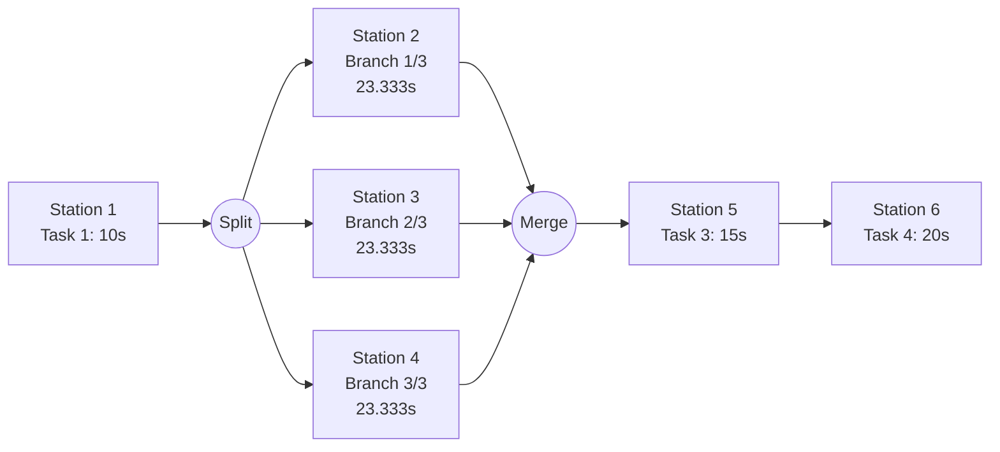

# MASTER BUILD SPECIFICATION
# IE cycle time — line balancing

**Version:** 2.1  
**Định hướng:** Compact layout, Focus control, preloaded defaults  
**Loại tài liệu:** Đặc tả sản phẩm, hành vi, dữ liệu, giao diện, xuất XLSX và kiểm thử  
**Ngôn ngữ tài liệu chính:** Tiếng Việt  
**Ngôn ngữ ứng dụng:** VI / EN  
**Nguồn tham chiếu:** HTML đính kèm và MASTER BUILD SPECIFICATION v2.1 của người dùng

---

## 0. Mục đích, nguồn và cách đọc tài liệu

### 0.1. Mục đích

Tài liệu này là đặc tả nguồn hợp nhất cho ứng dụng:

> IE cycle time — line balancing

Ứng dụng được triển khai dưới dạng một file HTML offline, bao gồm HTML, CSS, JavaScript và toàn bộ thành phần cần thiết để vận hành.

Tài liệu phục vụ:

1. Hiểu chính xác sản phẩm đang làm gì.
2. Phân biệt hành vi đã có trong HTML với yêu cầu cần đạt ở v2.1.
3. Hướng dẫn chỉnh sửa mà không làm mất các hành vi cần giữ.
4. Làm cơ sở đồng bộ giao diện VI/EN và Help.
5. Làm cơ sở kiểm thử chức năng, dữ liệu, Focus, allocation, Layout và XLSX.
6. Làm tài liệu bàn giao cho người phát triển hoặc một AI hỗ trợ build tiếp.

### 0.2. File HTML đã được đọc

| Thuộc tính | Giá trị |
|---|---|
| Tên file | `IE_cycle_time_line_balancing.html` |
| Kiểu nội dung | `text/html` |
| Dung lượng | 138.464 byte |
| Số dòng vật lý | 59 |
| Số khối JavaScript inline | 2 |
| Script/CSS external được khai báo | Không có |
| SHA-256 | `163f39b221d71a3e9b1702c217e4ad1dd25c2bea6e82307b07685055ebee84f0` |

HTML được viết khá gọn, nhiều phần CSS và JavaScript nằm trên cùng một dòng. Vì vậy, tên hàm và DOM ID thường hữu ích hơn số dòng khi tra cứu.

### 0.3. Phân biệt hiện trạng và yêu cầu đích

Tài liệu dùng ba cách diễn đạt:

- **Hiện trạng HTML:** hành vi nhìn thấy trực tiếp trong mã nguồn đính kèm.
- **Yêu cầu v2.1:** hành vi cần có theo ghi chú của người dùng.
- **Khuyến nghị kỹ thuật:** hướng triển khai hoặc kiểm thử để đạt yêu cầu; không tự động mở rộng phạm vi sản phẩm.

Khi hiện trạng HTML khác yêu cầu v2.1:

1. Ghi nhận hiện trạng trung thực.
2. Dùng yêu cầu v2.1 làm hành vi đích.
3. Không mô tả tính năng chưa có là đã hoàn thành.
4. Không giữ lỗi chỉ vì lỗi đang tồn tại trong mã nguồn.
5. Không thay đổi hành vi khác ngoài phạm vi được yêu cầu.

### 0.4. Lưu ý quan trọng về XLSX

File HTML đính kèm thực tế:

- Nhúng JSZip 3.10.2.
- Tạo ZIP bằng `new JSZip()`.
- Gọi `generateAsync()` với `compression: 'DEFLATE'`.

Trong khi ghi chú v2.1 yêu cầu:

- Bộ đóng gói ZIP tích hợp tự viết bằng JavaScript.
- CRC-32.
- ZIP method STORE.
- Không dùng thư viện ngoài.
- Không mô tả bản đích là đang dùng JSZip.

Vì vậy:

> “Không dùng JSZip” là yêu cầu đích v2.1, chưa phải hiện trạng của HTML đính kèm.

Nếu sau này HTML đã được thay exporter, cần cập nhật phần hiện trạng này theo file mới, không tiếp tục dựa vào nhận định của file cũ.

### 0.5. Phạm vi kiểm chứng đã thực hiện khi biên soạn

Đã thực hiện:

- Đọc toàn bộ nội dung HTML UTF-8.
- Tách và kiểm tra cấu trúc các khối CSS/JavaScript.
- Kiểm kê DOM IDs và tài nguyên script/CSS external.
- Đối chiếu các hàm và event handlers với ghi chú.
- Kiểm tra sự xuất hiện của API lưu trữ, request và confirmation trong JavaScript ứng dụng.
- Tính lại các ví dụ thống kê và allocation bằng Python theo công thức đặc tả.

Chưa thực hiện:

- Chạy ứng dụng trên Edge hoặc Chrome.
- Kiểm thử thao tác thực tế trên tablet.
- Kiểm thử JavaScript syntax bằng JavaScript runtime.
- Tạo XLSX bằng chính JavaScript trong HTML rồi mở bằng Excel.
- Xác nhận Excel không hiện thông báo repair.
- Kiểm thử beforeunload hoặc browser fullscreen.

Môi trường kiểm tra không có Node.js. Không được coi kiểm tra tĩnh hoặc Python reference calculation là kiểm thử chạy thành công ứng dụng HTML.

---

## 1. Định nghĩa sản phẩm

### 1.1. Mục tiêu

Ứng dụng offline dành cho hoạt động Industrial Engineering / Work Study, hỗ trợ:

1. Đo cycle time theo từng work element.
2. Đo nhiều LAP cho cùng element.
3. Đo tuần tự bằng Start measurement / Next element.
4. Chuyển trực tiếp sang element khác khi đang chạy.
5. Ghi nhận Changed station cho interval vừa rời đi.
6. Rà soát quan sát.
7. Chỉnh sửa ghi chú.
8. Xóa từng quan sát.
9. Tính sample count, Mean, P25, P50 và P75.
10. Nhập hoặc override representative times.
11. Cân bằng chuyền giữ thứ tự element.
12. Đề xuất nhánh song song khi một element vượt Target.
13. Hiển thị process-flow Layout.
14. Chuyển giao diện VI/EN.
15. Hiển thị tên element song ngữ với fallback.
16. Xuất XLSX hoàn toàn offline.
17. Sử dụng Focus mode cho tablet.
18. Xem Help / Description chi tiết theo từng tab.

### 1.2. Đối tượng sử dụng

- IE / Industrial Engineer.
- Người thực hiện time study.
- Người rà soát dữ liệu cycle time.
- Người lập phương án line balancing sơ bộ.
- Người cần trình bày flow station tuần tự hoặc song song.

### 1.3. Phạm vi kết quả

Ứng dụng tạo:

- Dữ liệu quan sát cycle time.
- Thống kê theo element.
- Phương án allocation đơn giản.
- KPI theo Target được nhập.
- Process-flow visualization.
- Workbook XLSX.

Ứng dụng không tự chứng minh:

- Phương án có thể triển khai ngoài hiện trường.
- Năng lực các nhánh thực tế bằng nhau.
- Số operator thực tế cần bố trí.
- Actual production output.
- Actual lead time.
- Tính an toàn hoặc phù hợp facility của Layout.

### 1.4. Thuật ngữ

| Thuật ngữ | Ý nghĩa |
|---|---|
| Work element | Một phần công việc có điểm bắt đầu/kết thúc xác định |
| Draft | Danh sách đang nhập/chỉnh trong editor |
| Loaded elements / `elems` | Danh sách đã áp dụng vào Process input |
| Observation | Một interval đo đã lưu |
| LAP | Lưu interval và tiếp tục đo cùng element |
| Next element | Lưu interval rồi chuyển sang element tiếp theo |
| Direct switch | Chuyển trực tiếp sang một hàng khác khi đang chạy |
| Changed station | Cờ của interval được lưu do direct switch |
| Representative time | Thời gian dùng làm đầu vào allocation |
| Target | Mục tiêu cycle time nhập trực tiếp |
| Station | Đơn vị allocation trong proposal |
| Parallel branch | Một nhánh song song được đề xuất cho task vượt Target |
| Effective branch time | Original representative time chia số nhánh |
| Accepted proposal | Proposal đã vượt qua validation và station limit |
| Snapshot | Bản chụp dữ liệu/đầu vào của proposal đã chấp nhận |
| Layout | Sơ đồ flow dựng từ accepted stations, không phải floor plan |
| Session | Vòng đời của tab hiện tại |

---

## 2. Bảng đối chiếu HTML đính kèm với v2.1

### 2.1. Các điểm khác biệt cần xử lý

| Hạng mục | Hiện trạng HTML | Yêu cầu v2.1 |
|---|---|---|
| Startup elements | 5 element | 6 element đúng danh sách quy định |
| Startup auto-load | Có gọi Load tự động lúc khởi tạo | Giữ khả năng có sẵn Process input ngay khi mở |
| Tên khu vực nhập | `1. Nạp work element` / `1. Load work elements` | `Nhập work elements` / `Input work elements` |
| Default template riêng | Chưa có template 6 element riêng | Template, draft và elems không dùng chung object |
| Body font | Chưa khai báo body khoảng 18px | Body khoảng 18px |
| Heading card | `h2` 17px | Khoảng 24px |
| Table font | 13px | Khoảng 17px |
| Shell | 1320px | Khoảng 1600px |
| Sidebar | 220px | Khoảng 185px |
| Study fields desktop | 3 cột | 6 trường trên một hàng |
| Card padding | 17px | Khoảng 14px |
| Station results | Nằm trong card Results | Hai station card trên một hàng |
| Focus entry | Nằm dưới đồng hồ, chung hàng controls | Nằm cạnh timer heading |
| Focus entry style | Class `light` | Teal đậm, chữ trắng, nổi bật |
| Timer controls | Căn giữa, nhưng `nowrap` | Căn giữa và cho phép wrap màn hình hẹp |
| Exit Focus | Dùng chung nút toggle với Focus entry | Giữ Exit Focus trong vùng controls khi active |
| Clear observations | Không có confirmation | Phải xác nhận |
| Clear proposal visuals | Xóa state nhưng không xóa trực tiếp toàn bộ KPI/stations/flow DOM | Không để UI hiển thị proposal cũ như còn hiệu lực |
| Representative state | Chủ yếu nằm trong input DOM | Có state rõ ràng theo thứ tự elems |
| Representative reset | Khi renderStd, vào tab balance hoặc đổi ngôn ngữ | Reset do thêm/xóa observation hoặc Load; không reset do đổi ngôn ngữ |
| Language change | Có thể gọi Create proposal lại | Chỉ đổi hiển thị, không tính lại proposal |
| Production validation | Chưa đầy đủ; hours/breaks không dùng trong validation | Validate Target, max, shift và breaks |
| Task finite check | Chỉ filter `time > 0` | Chỉ finite positive values được allocation |
| Export all enabling | Bật trước khi kiểm tra station limit | Chỉ bật sau valid accepted proposal |
| Parallel task identity | Không có `sourceIndex` | Có sourceIndex để nhận diện đúng task gốc |
| Parallel original time | Không có `originalTime` trên task copy | Có originalTime cho task song song |
| Layout grouping | Dựa vào parallelCount và tên fallback | Dựa vào sourceIndex, count và branch sequence |
| XLSX ZIP | JSZip 3.10.2 + DEFLATE | ZIP tích hợp + CRC-32 + STORE |
| Empty worksheet | Fallback thành cột `message` | Giữ đúng schema headers của sheet |
| Help VI/EN | Có nhưng chưa đầy đủ đối xứng | Cập nhật đủ cả VI và EN theo v2.1 |

### 2.2. Các hành vi nền đang có và cần giữ

Qua đọc mã nguồn, HTML đã có các nền tảng sau:

- Một file HTML với CSS/JavaScript inline.
- Không khai báo external script hoặc stylesheet.
- Không có `fetch()` hoặc `XMLHttpRequest` trong JavaScript ứng dụng.
- Không sử dụng localStorage, sessionStorage hoặc cookies trong JavaScript ứng dụng.
- Timer dùng `performance.now()`.
- Timestamp lưu bằng `new Date().toISOString()`.
- Metadata được đọc khi lưu observation.
- Draft editing không tự sửa Process input.
- Load tạo các object element mới.
- LAP lưu và tiếp tục cùng element.
- Next lưu và chuyển tuần tự.
- Final Next lưu rồi dừng.
- Direct switch gắn cờ cho element cũ.
- Stop không lưu interval đang dở.
- Stable key dùng cặp VI/EN.
- Statistics dùng linear interpolation.
- Detail giữ quan sát của element đã bị loại khỏi loaded list.
- Allocation giữ thứ tự, không sort.
- Task vượt Target được tách thành các station song song.
- Export all hiện chỉ khai báo ba sheet.
- Không có Layout sheet trong export all.
- Focus có CSS override sang flex column.
- Không có RAM-warning banner trên trang chính.

Các hành vi này không được làm mất trong quá trình chỉnh sửa.

---

## 3. Runtime và vòng đời dữ liệu

### 3.1. Yêu cầu runtime

Ứng dụng phải:

- Là một file `.html` duy nhất.
- Mã hóa UTF-8.
- Dùng HTML5, CSS và JavaScript.
- Mở trực tiếp bằng Edge hoặc Chrome.
- Không cần backend.
- Không cần login.
- Không cần database.
- Không cần CDN.
- Không gọi fetch hoặc API.
- Không dùng cookies.
- Không dùng localStorage.
- Không khôi phục dữ liệu từ sessionStorage hoặc cơ chế lưu bền tương tự.
- Không yêu cầu internet để đo, tính toán hoặc export.

### 3.2. Dữ liệu session

Dữ liệu làm việc chỉ nằm trong bộ nhớ của tab hiện tại.

Bao gồm:

- Metadata đang nhập.
- Draft.
- Loaded elements.
- Observations.
- Timer state.
- Representative overrides.
- Accepted proposal.
- Layout hiển thị.

Reload hoặc mở phiên app mới phải tạo lại trạng thái mặc định.

Không khôi phục:

- Observations cũ.
- Metadata đã sửa ở phiên trước.
- Draft đã sửa ở phiên trước.
- Representative overrides cũ.
- Proposal cũ.
- Trạng thái đang đo cũ.

### 3.3. Defaults không phải persistence

Startup defaults là dữ liệu mẫu được tạo lại khi khởi động.

Chúng không phải:

- Dữ liệu đo lưu từ lần trước.
- Dữ liệu nhập từ XLSX.
- Dữ liệu được phục hồi từ localStorage.
- Một cơ chế tự đồng bộ.

### 3.4. Không nhập lại XLSX

Ứng dụng không có chức năng:

- Import `time_study.xlsx`.
- Import `IE_cycle_time_all_data.xlsx`.
- Khôi phục session bằng workbook đã export.
- Merge workbook vào data.

Export là đầu ra, không phải cơ chế backup có thể import lại bằng app.

### 3.5. Đóng hoặc reload tab

Không có banner cảnh báo dữ liệu RAM trên trang chính.

Help phải giải thích rõ vòng đời session.

Có thể thêm hoặc giữ beforeunload confirmation khi:

- Có observations.
- Hoặc đang đo.

Hiện trạng HTML đính kèm không có beforeunload handler.

Nếu triển khai confirmation:

- Không được tuyên bố rằng dữ liệu đã tự lưu.
- Không được coi confirmation là cơ chế persistence.
- Không được làm gián đoạn thao tác đo bình thường.

---

## 4. State model và cấu trúc dữ liệu

### 4.1. State chính

| State | Kiểu / ý nghĩa | Giá trị đầu phiên |
|---|---|---|
| `lang` | `vi` hoặc `en` | `vi` |
| `draft` | Danh sách đang nhập/chỉnh | Bản sao riêng của 6 defaults |
| `elems` | Danh sách đã nạp | Bản sao riêng của 6 defaults |
| `data` | Observations | `[]` |
| `active` | Index đang đo; `-1` là idle | `-1` |
| `t0` | Performance start time | `0` hoặc chưa dùng |
| `tick` | Interval handle | Không có interval đang chạy |
| `representativeValues` | Giá trị theo thứ tự elems | Sáu giá trị `0` |
| `lastStations` | Accepted allocation snapshot | `[]` |
| `lastBalance` | Accepted metrics/input snapshot | `null` |

Focus state có thể được thể hiện bằng class `body.focus`, như cấu trúc hiện tại. Không bắt buộc tạo biến riêng nếu hành vi vẫn rõ ràng.

### 4.2. Element

```javascript
{
  vi: "",
  en: ""
}
```

Yêu cầu:

- Giữ tên VI và EN riêng.
- Không dùng tên hiển thị làm thay thế cho cả cặp dữ liệu.
- Chỉ cần một tên khác rỗng.
- Hai tên đều rỗng thì không đưa vào elems khi Load.

### 4.3. Stable key

Công thức bắt buộc:

```javascript
(vi || "") + "||" + (en || "")
```

Ví dụ:

```text
Lấy linh kiện 1||Pick component 1
```

Identity không phụ thuộc vào ngôn ngữ đang hiển thị.

Không tự đổi stable key sang:

- Index.
- Tên fallback.
- Product.
- Operator.
- Shift.
- Một tên chỉ bằng VI hoặc EN.

Nếu muốn thay cơ chế identity trong một phiên bản khác, đó là thay đổi model cần đặc tả và migration riêng, không phải chỉnh sửa giao diện.

### 4.4. Observation

```javascript
{
  timestamp,
  product,
  process,
  operator,
  operatorId,
  shift,
  shiftId,
  elementKey,
  elementVi,
  elementEn,
  seconds,
  changedStation,
  note
}
```

| Field | Ý nghĩa |
|---|---|
| `timestamp` | ISO timestamp tại thời điểm lưu interval |
| `product` | Product metadata tại thời điểm lưu |
| `process` | Process metadata tại thời điểm lưu |
| `operator` | Operator name tại thời điểm lưu |
| `operatorId` | Operator ID tại thời điểm lưu |
| `shift` | Shift tại thời điểm lưu |
| `shiftId` | Shift ID tại thời điểm lưu |
| `elementKey` | Key của element đang được lưu |
| `elementVi` | Tên VI được chụp khi lưu |
| `elementEn` | Tên EN được chụp khi lưu |
| `seconds` | Duration numeric, làm tròn 3 chữ số thập phân |
| `changedStation` | Boolean |
| `note` | Text tự do |

Observation phải lưu metadata và tên element dưới dạng snapshot, không tham chiếu ngược đến input hiện tại.

### 4.5. Station

```javascript
{
  time,
  tasks: [
    {
      nameVi,
      nameEn,
      time,
      originalTime,
      sourceIndex,
      parallelCount,
      parallelIndex
    }
  ]
}
```

Quy ước:

- `station.time`: tổng workload/effective workload của station.
- `task.time`: thời gian đóng góp vào station.
- `sourceIndex`: index của element gốc trong elems tại thời điểm tạo proposal.
- `parallelCount`: số nhánh của task gốc.
- `parallelIndex`: số nhánh, từ 1 đến n.
- `originalTime`: representative time gốc trước khi chia nhánh; cần cho task song song.

Task tuần tự:

```javascript
{
  nameVi,
  nameEn,
  time,
  sourceIndex,
  parallelCount: 1,
  parallelIndex: 1
}
```

Task song song:

```javascript
{
  nameVi,
  nameEn,
  time: originalTime / parallelCount,
  originalTime,
  sourceIndex,
  parallelCount,
  parallelIndex
}
```

Không dùng tên task làm identity duy nhất của nhóm song song.

### 4.6. Accepted balance snapshot

Hiện trạng HTML dùng:

```javascript
{
  takt,
  total,
  eff,
  stations
}
```

Có thể giữ các tên field này để hạn chế thay đổi exporter và rendering.

Yêu cầu v2.1 là snapshot phải chứa đủ ngữ cảnh của proposal đã chấp nhận, tối thiểu:

- Target.
- Work content.
- Efficiency.
- Station allocation.
- Đầu vào cần truy xuất lại ý nghĩa của proposal.

Có thể bổ sung:

- Shift hours.
- Break minutes.
- Maximum stations.
- Representative values tại thời điểm Create.
- Source element names/order.

Tên các field bổ sung là lựa chọn triển khai, không phải yêu cầu đặt tên bắt buộc.

Không được để sửa input hiện tại làm thay đổi snapshot cũ thông qua object reference.

### 4.7. Quy tắc object independence

Ba tầng sau phải độc lập:

1. Default template.
2. Draft.
3. Loaded elems.

Ví dụ khởi tạo tham khảo:

```javascript
const DEFAULT_ELEMENTS = [
  { vi: "Lấy linh kiện 1", en: "Pick component 1" },
  { vi: "Siết vít 1", en: "Tighten screw 1" },
  { vi: "Lấy linh kiện 2", en: "Pick component 2" },
  { vi: "Siết vít 2", en: "Tighten screw 2" },
  { vi: "Kiểm tra", en: "Inspection" },
  { vi: "Đóng gói", en: "Packing" }
];

const copyElements = list =>
  list.map(e => ({ vi: e.vi, en: e.en }));

let draft = copyElements(DEFAULT_ELEMENTS);
let elems = copyElements(DEFAULT_ELEMENTS);
let data = [];
let active = -1;
let representativeValues = elems.map(() => 0);
let lastStations = [];
let lastBalance = null;
```

Đây là mẫu khởi tạo, không phải yêu cầu thay toàn bộ kiến trúc ứng dụng.

Không dùng:

```javascript
draft = DEFAULT_ELEMENTS;
elems = DEFAULT_ELEMENTS;
```

Không dùng shallow copy mảng nếu các object bên trong vẫn bị chia sẻ:

```javascript
draft = [...DEFAULT_ELEMENTS];
elems = [...DEFAULT_ELEMENTS];
```

---

## 5. Startup defaults và reset đầu phiên

### 5.1. Default work elements v2.1

Mỗi lần mở hoặc reload app, tạo đúng sáu element:

| No. | VI | EN |
|---:|---|---|
| 1 | Lấy linh kiện 1 | Pick component 1 |
| 2 | Siết vít 1 | Tighten screw 1 |
| 3 | Lấy linh kiện 2 | Pick component 2 |
| 4 | Siết vít 2 | Tighten screw 2 |
| 5 | Kiểm tra | Inspection |
| 6 | Đóng gói | Packing |

Tên và thứ tự này là yêu cầu chính xác.

Không thay bằng danh sách năm element trong HTML cũ:

1. Lấy linh kiện / Pick component.
2. Lắp linh kiện / Assemble component.
3. Siết vít / Tighten screw.
4. Kiểm tra / Inspect.
5. Đóng gói / Pack.

### 5.2. Auto-populated Process input

Ngay khi mở app:

- Input editor có sáu defaults.
- Process input có cùng sáu defaults.
- Sample count của mỗi element bằng 0.
- Mean/P25/P50/P75 hiển thị `-`.
- Representative time bằng 0.
- Timer idle.
- Stop disabled.
- Không có observations.
- Chưa có accepted proposal.
- Export all disabled.

Không bắt người dùng nhấn Load ở lần mở đầu.

### 5.3. Immediate Start

Nhấn Bắt đầu đo ngay sau khi mở phải chạy element index 0:

> Lấy linh kiện 1

Không hiện thông báo “Hãy nạp work elements trước” khi defaults đã được nạp đúng.

### 5.4. Defaults chỉ xuất hiện đầu phiên

Trong cùng một session:

- Clear draft không tự khôi phục defaults.
- Load danh sách rỗng không tự khôi phục defaults.
- Xóa toàn bộ draft rồi render không tự thêm defaults.
- Xóa observations không khôi phục defaults.
- Đổi tab không khôi phục defaults.
- Đổi ngôn ngữ không khôi phục defaults.

Defaults chỉ được tạo lại khi mở hoặc reload trang.

### 5.5. Khởi tạo UI không được tạo side effect ngoài ý muốn

Có thể khởi tạo elems trực tiếp hoặc sử dụng helper chung với Load.

Tuy nhiên, startup rendering không được:

- Ghi observation.
- Chạy timer.
- Tạo proposal.
- Hiện confirmation không cần thiết.
- Tự kích hoạt Export all.

---

## 6. Giao diện compact

### 6.1. Theme

| Vai trò | Màu |
|---|---|
| Primary teal | `#0f766e` |
| Dark teal | `#115e59` |
| Navigation | `#0b2530` |
| Background | `#f3f7f6` |
| Border | `#d9e5e3` |
| Muted | `#64748b` |
| Orange | `#f59e0b` |
| Danger | `#dc2626` |
| Focus cyan | `#5eead4` |

Màu bright teal workload trong HTML hiện tại là `#2dd4bf`; có thể giữ cho ngưỡng utilization dưới 70%.

### 6.2. Typography

Mục tiêu:

- Body khoảng 18px.
- Inputs và buttons kế thừa font dễ đọc.
- Table khoảng 17px.
- Heading card khoảng 24px.
- Không giảm font để giải quyết khoảng trắng.
- Timer dùng tabular numerals.
- Số giây hiển thị rõ, không gây dịch chuyển layout khi chạy.

Không cần mọi text phụ đều bằng 18px, nhưng text quan trọng và vùng thao tác phải dễ đọc trên tablet.

### 6.3. Touch targets

- Input/button tối thiểu khoảng 48px.
- Nút remove vẫn phải thao tác được.
- LAP/Start ở từng hàng phải dễ bấm.
- Không tạo các controls quá nhỏ để đạt compact layout.
- Khoảng cách nút đủ để hạn chế bấm nhầm LAP, Next và Clear.

### 6.4. Spacing

Mục tiêu:

- Shell tối đa khoảng 1600px.
- Shell padding khoảng 12px.
- Gap giữa card khoảng 12px.
- Card padding khoảng 14px.
- Sidebar khoảng 185px.

Compact nghĩa là tận dụng không gian, không phải thu nhỏ mọi thành phần.

### 6.5. Desktop layout

Tab Time study:

1. Study information: sáu trường trên một hàng.
2. Input work elements và Cycle-time measurement: hai cột cạnh nhau.
3. Process input: toàn chiều ngang.
4. Observation table: toàn chiều ngang.

Tab Line balancing:

1. Production parameters: một card toàn chiều ngang.
2. Representative times và KPI: hai cột.
3. Kết quả station: hai station card trên một hàng.

Tab Layout:

- Process flow có vùng cuộn ngang riêng.

### 6.6. Responsive

Khoảng dưới 1150px:

- Study information có thể về ba cột.

Khoảng dưới 850px:

- Navigation chuyển thành ngang.
- Card chính về một cột.
- Study fields về hai cột.
- Production fields về hai cột.
- Bảng và Layout giữ khả năng cuộn ngang.
- Có thể ẩn percentile columns.

Không để responsive làm mất:

- Tên element.
- Start/LAP control.
- Timer.
- Main controls.
- Exit Focus.
- Khả năng xem dữ liệu bằng cuộn.

### 6.7. Process input trên màn hình nhỏ

HTML hiện tại ẩn toàn bộ `.stat` dưới breakpoint 850px.

Yêu cầu v2.1 cho phép ẩn percentile columns. Việc giữ hay ẩn thêm sample count/Mean cần được cân nhắc theo không gian, nhưng không được làm mất khả năng đo.

Nếu cải thiện chỉ nhằm giữ count/Mean trên màn hình nhỏ, phải kiểm thử riêng để không gây overflow controls.

### 6.8. Không có banner cảnh báo trên trang chính

Không thêm RAM-warning banner trên main workspace.

Thông tin session lifecycle phải nằm trong Help.

Các status bình thường như:

- Đang đo element nào.
- Chưa có proposal.
- Layout đã cập nhật.

không phải RAM-warning banner và có thể giữ.

---

## 7. Navigation, ngôn ngữ và nhãn

### 7.1. Các tab

Ứng dụng có ba tab:

1. Time study / Bấm giờ.
2. Line balancing.
3. Layout.

Đổi tab chỉ thay nội dung đang xem.

Không tự:

- Dừng timer.
- Lưu interval.
- Xóa observations.
- Reset representative overrides.
- Tạo lại proposal.

### 7.2. Ngôn ngữ

`lang` chỉ có:

- `vi`.
- `en`.

Nút language có thể hiển thị ngôn ngữ sẽ chuyển sang:

- Khi đang VI, hiển thị EN.
- Khi đang EN, hiển thị VI.

### 7.3. Fallback tên element

VI:

```javascript
element.vi || element.en
```

EN:

```javascript
element.en || element.vi
```

Fallback dùng cho hiển thị.

Không dùng fallback làm key thống kê hoặc identity nhánh song song.

### 7.4. Nhãn bắt buộc

| Thành phần | VI | EN |
|---|---|---|
| Khu vực nhập | Nhập work elements | Input work elements |
| Khu vực đo | Đo cycle time | Cycle-time measurement |
| Focus entry | Focus mode | Focus mode |
| Exit Focus | Thoát Focus | Exit Focus |
| Main control khi idle | Bắt đầu đo | Start measurement |
| Main control khi chạy | Element tiếp theo | Next element |
| Stop | Dừng | Stop |
| Clear observations | Xóa kết quả đo | Clear observations |
| Row control idle/inactive | Bắt đầu | Start |
| Row control active | LAP | LAP |

Không dùng tiêu đề:

- Soạn work elements.
- Work-element draft.

Danh sách vẫn có semantics draft, nhưng đó là model, không phải tên heading.

### 7.5. Ngôn ngữ không được thay dữ liệu

Đổi VI/EN không được:

- Reset t0.
- Tạo observation.
- Xóa observation.
- Thay metadata đã lưu.
- Thay elementKey.
- Thay representative override.
- Gọi allocation.
- Thay accepted station assignment.
- Thay accepted Target.
- Thay KPI numeric values.

Các thành phần chỉ được render lại theo ngôn ngữ:

- Labels.
- Active element name.
- Process input names.
- Observation element names.
- Representative element labels.
- Station task names.
- Layout task names.
- Help content.
- Focus exit label.

### 7.6. Lỗi hiện trạng cần loại bỏ

Trong HTML cũ, `applyLang()`:

1. Gọi `renderAll()`.
2. Gọi `renderStd()`, reset inputs về Mean.
3. Nếu có stations, gọi `balanceBtn.click()`.

Hệ quả:

- Override có thể bị mất.
- Proposal có thể bị tính lại.
- Accepted snapshot có thể bị thay đổi.

Ở v2.1, language rendering phải tách khỏi các mutation này.

---

## 8. Tab 01 — Time study

### 8.1. Study information

Defaults:

| Field | Default |
|---|---|
| Product | Model A |
| Process | NPI |
| Operator | Nguyễn Văn A |
| Operator ID | ABC012345 |
| Shift | 1 |
| Shift ID | A |

Các input được phép sửa trong session.

### 8.2. Thời điểm chụp metadata

Metadata được đọc khi lưu interval.

Không phải lúc bắt đầu.

Ví dụ:

1. Start lúc Product là `Model A`.
2. Đổi Product thành `Model B` khi timer đang chạy.
3. Nhấn LAP.

Observation mới mang Product `Model B`.

Observation đã lưu trước đó vẫn giữ metadata cũ.

### 8.3. Không dùng metadata làm grouping mặc định

Statistics theo `elementKey`.

Không tự chia theo:

- Product.
- Process.
- Operator.
- Operator ID.
- Shift.
- Shift ID.

Nếu cùng element được đo ở nhiều metadata khác nhau, tất cả observations cùng key vẫn đi vào thống kê.

Help phải nêu điều này để tránh hiểu nhầm Summary là thống kê theo từng product/operator/shift.

---

## 9. Nhập work elements

### 9.1. Cấu trúc editor

Header:

| No. | VI | EN | Remove |
|---:|---|---|---|

Yêu cầu:

- No. tự đánh số theo thứ tự draft.
- Có ô VI.
- Có ô EN.
- Có nút remove từng dòng.
- Editor có cuộn nội bộ.
- Header sticky.
- Không cần cả hai ngôn ngữ đều có tên.

### 9.2. Add

Add:

- Thêm một dòng trống vào draft.
- Không sửa elems.
- Không tạo observation.
- Không sửa proposal.
- Không reset timer.

### 9.3. Remove

Remove:

- Xóa đúng dòng draft được chọn.
- Các dòng sau được đánh số lại.
- Không xóa element tương ứng trong Process input khi chưa Load.
- Không xóa observation lịch sử.
- Không xóa proposal.

### 9.4. Clear draft

Clear draft:

```javascript
draft = [];
```

Chỉ tác động draft.

Không xóa:

- Metadata.
- Elems.
- Observations.
- Representative values của elems.
- Accepted proposal.

Không tự khôi phục defaults giữa session.

### 9.5. Load

Load thực hiện đúng thứ tự logic:

1. Nếu đang đo, dừng timer.
2. Bỏ interval đang dở, không lưu.
3. Đọc draft hiện tại.
4. Trim tên VI và EN.
5. Bỏ dòng có cả hai tên trống.
6. Tạo các object element mới.
7. Thay elems bằng danh sách mới.
8. Giữ đúng thứ tự draft.
9. Render Process input.
10. Tính lại statistics theo key mới.
11. Reset representative values về Mean của loaded elements.

Load không tự xóa:

- Observation lịch sử.
- Accepted proposal trước đó.

### 9.6. Load rỗng

Nếu draft không còn dòng hợp lệ:

- `elems = []`.
- Process input rỗng.
- Representative list rỗng.
- Start measurement phải alert và không chạy.
- Data lịch sử vẫn còn.
- Proposal cũ, nếu có, vẫn là snapshot cũ cho đến khi Clear observations hoặc Create thành công proposal khác.

Không tự chèn sáu defaults vào session này.

### 9.7. Sửa tên và identity

Ví dụ:

- Element cũ: `Kiểm tra||Inspection`.
- Draft được sửa EN thành `Quality inspection`.
- Nhấn Load.

Key mới:

```text
Kiểm tra||Quality inspection
```

Observations key cũ:

- Vẫn nằm trong Detail.
- Không tự chuyển sang key mới.
- Không tham gia statistics của key mới.

Không có rename migration trong phạm vi v2.1.

### 9.8. Duplicate elements

Hai loaded rows có cùng cặp VI/EN:

- Có cùng elementKey.
- Dùng chung tập observations.
- Hiển thị cùng count/Mean/percentiles.
- Vẫn là hai vị trí riêng trong process order.
- Có representative input riêng theo vị trí.
- Có `sourceIndex` riêng khi allocation.

Đây là lý do Layout không được nhóm nhánh chỉ theo tên.

---

## 10. Timer và transition model

### 10.1. Clock sources

Duration:

```javascript
performance.now()
```

Timestamp:

```javascript
new Date().toISOString()
```

Không tính duration bằng:

```javascript
new Date() - startDate
```

Không lấy duration bằng chênh lệch đồng hồ hệ thống.

### 10.2. Duration lưu

```javascript
seconds =
  +((endPerformanceTime - startPerformanceTime) / 1000)
    .toFixed(3);
```

`seconds` phải là number, không phải string.

### 10.3. Timer display

Idle:

```text
00:00.000
```

Format:

```text
MM:SS.mmm
```

Có thể tiếp tục tăng minutes vượt hai chữ số nếu session đo dài.

Hiện trạng HTML cập nhật display bằng interval khoảng 25ms.

Tần suất display update không phải độ chính xác được bảo đảm của thao tác đo. Duration lưu lấy từ performance boundary, không cộng các tick.

### 10.4. Idle state

- `active = -1`.
- Không có running interval.
- Display reset.
- Stop disabled.
- Main control là Bắt đầu đo / Start measurement.

### 10.5. Main Start

Nếu `elems.length === 0`:

- Alert theo ngôn ngữ.
- Không chạy timer.
- Không tạo observation.

Nếu có elems:

- Bắt đầu index 0.
- Set t0.
- Enable Stop.
- Main control đổi thành Next.
- Active row nổi bật.
- Active row control đổi thành LAP.

### 10.6. Start trên một hàng

Khi idle:

- Nhấn Start ở hàng i.
- Bắt đầu element i.
- Không bắt buộc chạy từ element 1.
- Không tạo observation ngay lúc Start.

### 10.7. LAP

Chỉ hàng active có nút LAP.

Khi nhấn:

1. Lấy endPerformanceTime.
2. Lưu interval của element active.
3. `changedStation = false`.
4. Note mặc định rỗng.
5. Reset t0 tại cùng boundary.
6. Tiếp tục đo cùng element.
7. Cập nhật observations/statistics.
8. Reset representative values về Mean.
9. Không tự tính lại proposal.

LAP không chuyển active index.

### 10.8. Next

Khi đang chạy và chưa phải element cuối:

1. Lưu interval hiện tại.
2. `changedStation = false`.
3. Bắt đầu element kế tiếp.
4. Cập nhật active row.

Khi đang ở element cuối:

1. Lưu interval cuối.
2. Chỉ lưu đúng một lần.
3. Dừng timer.
4. Reset display và controls về idle.

Không để Stop lưu thêm cùng interval.

### 10.9. Direct switch

Khi đang chạy element i và nhấn control của element j khác i:

1. Lưu interval của i.
2. `changedStation = true`.
3. Note mặc định là chuỗi chính xác:

```text
changed station
```

4. Bắt đầu element j.
5. Cờ thuộc interval của element i, không thuộc interval mới của j.

Direct switch có thể:

- Tiến sang hàng sau.
- Quay về hàng trước.
- Bỏ qua nhiều hàng.

Không có logic tự tạo observation cho các hàng bị bỏ qua.

### 10.10. Stop

Stop:

- Clear interval handle.
- Không lưu interval đang dở.
- `active = -1`.
- Reset display.
- Reset main label.
- Disable Stop.
- Render lại active highlighting.

Stop không xóa observations đã lưu.

### 10.11. Load khi đang đo

Load có cùng nguyên tắc bỏ interval dở như Stop.

Không lưu interval trước khi thay elems.

Điều này tránh observation bị lưu với tên/key của một danh sách đã thay đổi.

### 10.12. Clear observations

Quy trình:

1. Yêu cầu xác nhận.
2. Nếu người dùng hủy: không đổi state.
3. Nếu xác nhận:
   - Dừng timer.
   - Bỏ interval dở.
   - `data = []`.
   - Reset representative values về 0 theo elems.
   - `lastStations = []`.
   - `lastBalance = null`.
   - Disable Export all.
   - Xóa proposal/KPI/flow cũ khỏi trạng thái hiển thị hiệu lực.
   - Render observations và statistics rỗng.

Giữ:

- Metadata.
- Draft.
- Elems.
- Ngôn ngữ.

Không tự khôi phục defaults.

### 10.13. Transition table

| State hiện tại | Action | Có lưu? | Changed station | State sau |
|---|---|---:|---|---|
| Idle | Main Start, có elems | Không | — | Chạy index 0 |
| Idle | Main Start, elems rỗng | Không | — | Idle + alert |
| Idle | Row Start i | Không | — | Chạy i |
| Chạy i | LAP hàng i | Có | false | Tiếp tục i |
| Chạy i | Next, còn hàng sau | Có | false | Chạy i+1 |
| Chạy hàng cuối | Next | Có, một lần | false | Idle |
| Chạy i | Row control j khác i | Có cho i | true | Chạy j |
| Chạy i | Stop | Không | — | Idle |
| Chạy i | Load | Không | — | Idle + elems mới |
| Bất kỳ | Clear confirmed | Không lưu interval dở | — | Idle, data/proposal rỗng |
| Bất kỳ | Language change | Không | — | Giữ timer state |
| Bất kỳ | Tab change | Không | — | Giữ timer state |
| Bất kỳ | Enter/Exit Focus | Không | — | Giữ timer state |

### 10.14. Ghi chú kỹ thuật về boundary

LAP trong HTML hiện tại:

- Lấy performance time.
- Lưu observation.
- Gán t0 bằng chính performance time vừa lấy.

Next/direct switch trong HTML hiện tại gọi save rồi start, và start lấy performance time mới.

Không được mô tả toàn bộ chuỗi element như một phép đo continuous tổng thời gian không có khoảng chuyển giao, trừ khi một phiên bản mới đã đặc tả và kiểm thử điều đó.

Yêu cầu v2.1 bắt buộc LAP reset tại cùng boundary; không cần tự ý thay toàn bộ timing model khác nếu không được yêu cầu.

---

## 11. Statistics

### 11.1. Tập mẫu

Tập mẫu của loaded element i:

```javascript
data
  .filter(x => x.elementKey === key(elems[i]))
  .map(x => x.seconds);
```

Dùng tất cả observations còn lại cùng key.

Không tự loại:

- Outlier.
- Changed station.
- Observation có note.
- Observation khác product/operator/shift.

### 11.2. Count

```text
samples = số observation còn lại cùng key
```

Count không phải số lần Start.

Một Start chưa có LAP/Next/direct switch vẫn chưa tạo sample.

### 11.3. Mean

\[
Mean = \frac{\sum_{i=1}^{n} seconds_i}{n}
\]

Không mẫu:

- Count = 0.
- UI statistics = `-`.
- Representative default = 0.

### 11.4. Percentiles

Sắp xếp tăng dần:

```text
x[0] ≤ x[1] ≤ ... ≤ x[n-1]
```

Với percentile p:

```text
q = (n - 1) × p
lo = floor(q)
hi = ceil(q)

P = x[lo] + (x[hi] - x[lo]) × (q - lo)
```

Các p:

- P25: 0.25.
- P50: 0.50.
- P75: 0.75.

Không dùng phương pháp nearest-rank thay thế.

### 11.5. Một mẫu

Nếu chỉ có một sample t:

- Mean = t.
- P25 = t.
- P50 = t.
- P75 = t.

### 11.6. Ví dụ chuẩn

Dữ liệu:

```text
4, 5, 6, 9
```

Kết quả:

| Statistic | Seconds |
|---|---:|
| Count | 4 |
| Mean | 6.000 |
| P25 | 4.750 |
| P50 | 5.500 |
| P75 | 6.750 |

Diễn giải:

```text
P25:
q = 3 × 0.25 = 0.75
P25 = 4 + (5 - 4) × 0.75 = 4.75

P50:
q = 3 × 0.50 = 1.50
P50 = 5 + (6 - 5) × 0.50 = 5.50

P75:
q = 3 × 0.75 = 2.25
P75 = 6 + (9 - 6) × 0.25 = 6.75
```

### 11.7. Precision

- Observation seconds lưu 3 chữ số thập phân.
- UI Mean/percentiles hiển thị 3 chữ số thập phân.
- Summary export giữ numeric cells, với values làm tròn 3 chữ số thập phân như logic hiện tại.

Không làm tròn từng bước của percentile rồi dùng kết quả đã làm tròn để tính tiếp.

### 11.8. Update rules

Thêm observation:

- Cập nhật statistics.
- Reset representative inputs về Mean.
- Không tự Create proposal.

Xóa observation:

- Cập nhật statistics.
- Reset representative inputs về Mean.
- Không tự Create proposal.

Load:

- Tính statistics theo loaded keys mới.
- Reset representative inputs về Mean.
- Không tự Create proposal.

Sửa note:

- Không đổi seconds.
- Không đổi flag.
- Không đổi statistics.
- Không reset representative inputs.
- Không tự Create proposal.

---

## 12. Observation table

### 12.1. Columns

| No. | Element | Seconds | TimeStamp | Changed station | Action | Note |
|---:|---|---:|---|---|---|---|

### 12.2. Hiển thị element

VI:

```javascript
observation.elementVi || observation.elementEn
```

EN:

```javascript
observation.elementEn || observation.elementVi
```

Dùng tên đã lưu trong observation.

Không lấy tên hiện tại từ elems để thay tên lịch sử.

### 12.3. Thứ tự bảng

HTML hiện tại hiển thị observation mới nhất lên đầu.

No. vẫn được lấy theo vị trí của observation trong data trước khi reverse phần hiển thị.

Ví dụ:

- Observation mới nhất có thể nằm trên cùng với No. lớn nhất.
- Xóa một observation khiến No. được tính lại từ data hiện tại.

No. không phải stable observation ID.

Nếu giữ cấu trúc index-based, event delete/note phải luôn trỏ đúng observation sau mỗi lần render.

### 12.4. Seconds

Hiển thị:

```text
0.000
```

Dữ liệu vẫn là numeric.

### 12.5. Timestamp

State lưu ISO.

UI hiển thị local time:

```text
HH:MM:SS DD-MMM-YYYY
```

Tháng dùng English abbreviations:

```text
Jan Feb Mar Apr May Jun Jul Aug Sep Oct Nov Dec
```

Ví dụ:

```text
14:35:08 25-Nov-2026
```

Không dùng locale-dependent month name thay đổi theo browser language.

Không nhầm local display với UTC ISO string đã lưu trong state.

### 12.6. Changed station

Nếu true:

```text
⚑ changed station
```

Nếu false:

```text
-
```

Trong XLSX:

- True → `Yes`.
- False → `No`.

Cờ không tự loại observation khỏi statistics.

### 12.7. Note

- Editable.
- Text tự do.
- Độc lập với changedStation.
- Sửa note không sửa flag.
- Xóa note không xóa flag.
- Nhập chữ `changed station` vào note của một observation false không biến flag thành true.

### 12.8. Delete

Delete chỉ xóa observation tương ứng.

Không xóa:

- Tất cả observations cùng key.
- Loaded element.
- Draft row.
- Proposal snapshot.

Sau Delete:

- Statistics cập nhật.
- Representative values reset về Mean.
- Accepted proposal giữ nguyên cho đến khi Create lại hoặc Clear observations.

### 12.9. Historical observations

Detail vẫn chứa observations của element:

- Đã bị remove khỏi draft rồi Load.
- Đã bị đổi tên rồi Load.
- Không còn trong loaded elems.

Summary chỉ gồm loaded elements hiện tại.

Đây là khác biệt chủ ý giữa Detail và Summary.

---

## 13. Focus mode

### 13.1. Mục tiêu

Focus mode tối ưu thao tác đo tại hiện trường, đặc biệt trên tablet.

Không bắt buộc gọi browser fullscreen API.

Focus là chế độ bố trí UI, không phải chức năng lưu dữ liệu.

### 13.2. Entry button

Nhãn chính xác:

```text
Focus mode
```

Giống nhau trong VI và EN.

Vị trí:

- Cạnh heading Đo cycle time / Cycle-time measurement.
- Không nằm trong hàng controls dưới timer.

Style:

- Teal đậm.
- Chữ trắng.
- Có border/accent hoặc điểm nhấn rõ.
- Có thể thêm icon fullscreen.
- Không bắt buộc icon hoặc browser fullscreen.

### 13.3. Exit control

Khi Focus active:

- Có Thoát Focus / Exit Focus trong vùng điều khiển.
- Luôn truy cập được.
- Không bị che bởi scroll vùng Process input.
- Không phụ thuộc vào header/sidebar đang ẩn.

### 13.4. Nội dung ẩn

Ẩn:

- App header.
- Sidebar/navigation.
- Study information.
- Input work elements editor.
- Observation table.
- Các card phụ không phục vụ đo trực tiếp.

### 13.5. Nội dung giữ

Giữ:

- Timer heading.
- Active element/status.
- Timer display.
- Main Start/Next.
- Stop.
- Clear observations.
- Exit Focus.
- Process input với Start/LAP và statistics phù hợp.

### 13.6. Layout Focus

- Full-width workspace.
- Override grid thành flex column.
- Timer card khoảng 42% viewport.
- Process input chiếm phần còn lại.
- Process input cuộn được.
- Có cuộn ngang nếu hàng rộng.
- Timer/controls không bị đẩy vào vùng khó truy cập.

HTML hiện tại đã có override `display:flex !important` cho Focus grid. Khi sửa compact layout phải giữ tác dụng này, tránh rule grid mới ghi đè.

### 13.7. Controls alignment

Controls dưới timer phải căn giữa trong cả:

- Normal mode.
- Focus mode.

Bao gồm:

- Start measurement / Next element.
- Stop.
- Clear observations.
- Exit Focus khi active.

Màn hình hẹp:

- Cho phép wrap.
- Mỗi hàng vẫn centered.
- Không override `justify-content: flex-start`.

Ví dụ CSS định hướng:

```css
.timer-controls {
  display: flex;
  justify-content: center;
  align-items: center;
  flex-wrap: wrap;
  gap: 8px;
}
```

Tên class là lựa chọn triển khai; có thể tiếp tục dùng `.center`.

### 13.8. State preservation

Enter/Exit Focus không được:

- Reset timer.
- Dừng timer.
- Lưu interval.
- Xóa data.
- Reset representative values.
- Tính lại proposal.

Đổi tab cũng không tự dừng timer.

Không tự thêm hành vi “đổi tab thì thoát Focus” nếu chưa được yêu cầu.

### 13.9. Kiểm thử chiều cao viewport

Cần kiểm thử tablet landscape và màn hình thấp.

Mục tiêu:

- Exit Focus không bị cắt.
- Clear observations không bị mất.
- Timer display không chiếm hết controls.
- Process input còn vùng thao tác được.
- Body overflow không khiến người dùng bị kẹt trong Focus.

---

## 14. Representative times và synchronization

### 14.1. Một input trên mỗi loaded element

Tab Line balancing có một representative input cho mỗi phần tử trong elems.

Thứ tự giống Process input.

Không sort theo Mean hoặc theo tên.

### 14.2. Default

- Có samples: Mean.
- Không samples: 0.

Có thể giữ numeric step `.001` như HTML hiện tại.

### 14.3. Override

Người dùng được sửa representative time.

Override chỉ tác động input allocation.

Không sửa:

- Observation seconds.
- Mean.
- P25/P50/P75.
- Summary statistics.

### 14.4. Giá trị được allocation

Chỉ values:

```javascript
Number.isFinite(value) && value > 0
```

mới đi vào allocation.

Không đưa vào:

- 0.
- Số âm.
- NaN.
- Infinity.
- -Infinity.

Các task hợp lệ còn lại giữ thứ tự gốc.

Không dùng `.filter(x => x.time > 0)` như kiểm tra duy nhất.

### 14.5. Reset events

Reset representative values về Mean khi:

- Lưu LAP.
- Lưu Next.
- Lưu direct switch.
- Xóa observation.
- Load elems mới.
- Clear observations.

Không reset khi:

- Sửa note.
- Đổi ngôn ngữ.
- Đổi tab.
- Enter/Exit Focus.
- Draw Layout.
- Export.
- Sửa production parameters.

### 14.6. Tách state và rendering

Ở v2.1 cần phân biệt:

- Hàm tính Mean/default representatives.
- Hàm reset representative state.
- Hàm render representative inputs.
- Hàm render labels theo ngôn ngữ.

Không dùng việc render lại input list làm lý do reset về Mean.

Ví dụ:

```text
resetRepresentativesToMean()
    → cập nhật state do data/load mutation

renderRepresentativeInputs()
    → hiển thị state hiện tại

renderLanguage()
    → đổi tên/labels nhưng giữ numeric values
```

Không bắt buộc các tên hàm này, nhưng bắt buộc tách semantics.

### 14.7. Proposal không tự theo representative input

Sửa representative input không tự:

- Allocation lại.
- Đổi KPI.
- Đổi stations.
- Đổi Layout.

Phải nhấn Create proposal.

---

## 15. Tab 02 — Line balancing

### 15.1. Production input defaults

| Input | Default |
|---|---:|
| Shift hours | 8 |
| Break minutes | 40 |
| Target seconds | 60 |
| Maximum stations | 25 |

### 15.2. Validation

| Input | Điều kiện |
|---|---|
| Target | Numeric hợp lệ, lớn hơn 0 |
| Maximum stations | Integer lớn hơn 0 |
| Shift hours | Numeric hợp lệ, lớn hơn 0 |
| Break minutes | Numeric hợp lệ, không âm |
| Break minutes | Không vượt `shiftHours × 60` |

Nên dùng finite checks để tránh numeric đặc biệt lọt vào allocation.

Ví dụ maximum stations:

```javascript
Number.isInteger(maxStations) && maxStations > 0
```

Không chấp nhận:

- 0.
- Số âm.
- 2.5.
- NaN.
- Infinity.

### 15.3. Shift và breaks là bối cảnh

Shift/breaks không tự suy ra:

- Target.
- Takt theo demand.
- Output.
- Capacity.
- Efficiency.

Target được nhập trực tiếp.

Nếu UI còn dùng nhãn `Target cycle time / Takt`, Help phải làm rõ app không có demand input và không tự tính takt từ demand.

### 15.4. Không có positive tasks

Nếu sau filtering không còn task hợp lệ:

- Không tạo proposal.
- Không overwrite accepted snapshot.
- Không bật Export all nếu trước đó chưa có proposal.
- Thông báo rõ theo VI/EN.

Nếu đã có accepted proposal:

- Giữ proposal cũ.
- Không giả vờ input rỗng vừa tạo được proposal mới.

### 15.5. Validation failure

Bất kỳ validation failure nào phải:

- Từ chối proposal mới.
- Không sửa lastStations.
- Không sửa lastBalance.
- Không sửa KPI của accepted proposal.
- Không sửa Layout thành proposal lỗi.
- Giữ Export all đúng theo sự tồn tại của accepted proposal.

---

## 16. Allocation algorithm

### 16.1. Nguyên tắc

- Giữ thứ tự Process input.
- Không sort tasks.
- Không backfill các station cũ.
- Không tối ưu bằng cách đổi thứ tự.
- Không tạo station trống cho đủ maximum.
- Maximum stations là giới hạn, không phải số station phải sử dụng.

### 16.2. Task tuần tự: time ≤ Target

Với task có time không vượt Target:

1. Nếu chưa có current station, mở station.
2. Nếu current.time + task.time ≤ Target:
   - Thêm task vào current.
3. Nếu không vừa:
   - Mở station mới.
   - Thêm task vào station mới.

Không quay lại tìm station cũ còn chỗ trống.

### 16.3. Task song song: time > Target

Với task vượt Target:

```text
parallelCount = ceil(task.time / Target)
effectiveTime = task.time / parallelCount
```

Quy trình:

1. Kết thúc nhóm tuần tự hiện tại bằng `current = null`.
2. Tạo `parallelCount` station.
3. Mỗi station chứa một task copy.
4. Mỗi copy có cùng sourceIndex.
5. Mỗi copy có cùng parallelCount.
6. Branch index từ 1 đến n.
7. Task kế tiếp bắt đầu một nhóm tuần tự mới.

Không ghép task kế tiếp vào một branch station.

### 16.4. Thời gian gốc và thời gian hiệu dụng

Ví dụ:

```text
Original representative time = 5.4s
Target = 3.0s
Branches = 2
Effective branch time = 2.7s
```

`2.7s` không phải một observation mới.

Không thay Mean `5.4s` thành `2.7s`.

Không sửa time study data do allocation.

### 16.5. Pseudocode

```text
stations = []
current = null

for task in valid tasks, giữ thứ tự:
    if task.time > Target:
        current = null
        n = ceil(task.time / Target)
        effective = task.time / n

        for branch = 1..n:
            append station:
                time = effective
                tasks = [
                    task copy:
                        time = effective
                        originalTime = task.time
                        sourceIndex = task.sourceIndex
                        parallelCount = n
                        parallelIndex = branch
                ]
    else:
        if current không tồn tại:
            tạo current station
        else if current.time + task.time > Target:
            tạo current station mới

        append task vào current.tasks
        current.time += task.time

if station count > max:
    reject candidate
else:
    accept candidate snapshot
```

### 16.6. Candidate và accepted state

Allocation phải tạo candidate trước.

Không gán lastStations/lastBalance trước khi kiểm tra:

- Input validity.
- Có task hợp lệ.
- Station count limit.

Chỉ commit khi candidate hợp lệ.

### 16.7. Station limit

Nếu candidate vượt maximum:

- Alert/thông báo.
- Reject proposal mới.
- Giữ accepted proposal trước đó nếu có.
- Không cập nhật KPI theo candidate bị reject.
- Không cập nhật Layout.
- Không bật Export all chỉ vì nút Create vừa được nhấn.

Nếu chưa từng có valid proposal:

- Last stations vẫn rỗng.
- Last balance vẫn null.
- Export all vẫn disabled.

### 16.8. Tối ưu kiểm tra giới hạn

Có thể kiểm tra số station cần thiết trong lúc build candidate để tránh tạo danh sách quá lớn.

Đây là tối ưu kỹ thuật được phép nếu kết quả allocation và rejection semantics không thay đổi.

Không truncate stations về max và coi là valid proposal.

---

## 17. KPI và utilization

### 17.1. Work content

\[
WorkContent = \sum OriginalRepresentativeTaskTimes
\]

Chỉ cộng valid positive tasks.

Task song song:

- Cộng original time một lần.
- Không cộng original time n lần cho n branches.

Tổng effective workloads của n branch cũng bằng original task time về mặt model.

### 17.2. Station count

```text
Station count =
  số station tuần tự
  + tất cả parallel branch stations
```

Không tính một nhóm parallel là một station duy nhất.

### 17.3. Efficiency

\[
Efficiency =
\frac{WorkContent}
{StationCount \times Target}
\times 100
\]

Không dùng shift hours hoặc break minutes trong công thức này.

### 17.4. Utilization

\[
Utilization_s =
\frac{StationTime_s}{Target}
\times 100
\]

### 17.5. Màu

| Utilization | Màu |
|---|---|
| < 70% | Bright teal |
| ≥ 70% và < 85% | Teal |
| ≥ 85% | Orange |

Boundary tests:

- 69.9% → bright teal.
- 70.0% → teal.
- 84.9% → teal.
- 85.0% → orange.

HTML Help cũ có nhắc màu đỏ nếu vượt Target, nhưng mã station color hiện tại chỉ có ba nhánh màu trên. V2.1 không yêu cầu một ngưỡng đỏ riêng cho utilization.

Danger đỏ vẫn dùng cho destructive controls hoặc lỗi phù hợp.

### 17.6. Display rounding

Có thể giữ quy ước hiện tại:

- Target KPI: 2 decimals.
- Work content KPI: 2 decimals.
- Station time: 2 decimals.
- Efficiency: 1 decimal.
- Export station workload: 3 decimals.
- Export utilization: 1 decimal.

Không dùng display-rounded values làm đầu vào allocation.

### 17.7. Không diễn giải quá mức KPI

Efficiency là metric của model allocation theo Target.

Không tự gọi nó là:

- Actual production efficiency.
- OEE.
- Labor productivity đo thực tế.
- Actual line throughput.
- Bảo đảm đạt demand.

---

## 18. Ví dụ allocation chuẩn

### 18.1. Sequential

Input:

```text
Tasks = [10, 15, 20]
Target = 30
```

Allocation:

| Station | Tasks | Workload |
|---|---|---:|
| 1 | 10 + 15 | 25 |
| 2 | 20 | 20 |

Metrics:

```text
Work content = 45
Station count = 2
Efficiency = 45 / (2 × 30) × 100 = 75%
```

Không backfill hoặc reorder.

### 18.2. Parallel

Input:

```text
Tasks = [5.4]
Target = 3
```

Calculation:

```text
parallelCount = ceil(5.4 / 3) = 2
effectiveTime = 5.4 / 2 = 2.7
```

Allocation:

| Station | Branch | Workload |
|---|---|---:|
| 1 | 1/2 | 2.7 |
| 2 | 2/2 | 2.7 |

Metrics:

```text
Work content = 5.4
Station count = 2
Efficiency = 90%
Utilization mỗi branch = 90%
```

### 18.3. Mixed

Input:

```text
Tasks = [10, 70, 15, 20]
Target = 30
```

Allocation:

| Station | Task / Branch | Workload |
|---|---|---:|
| 1 | Task 1 | 10.000 |
| 2 | Task 2, Branch 1/3 | 23.333... |
| 3 | Task 2, Branch 2/3 | 23.333... |
| 4 | Task 2, Branch 3/3 | 23.333... |
| 5 | Task 3 | 15.000 |
| 6 | Task 4 | 20.000 |

Task 3 không ghép vào branch station.

Task 3 và Task 4 không vừa cùng station vì:

```text
15 + 20 > 30
```

Metrics:

```text
Work content = 115
Station count = 6
Efficiency = 115 / 180 × 100
           = 63.888...%
```

### 18.4. Exact target

Input:

```text
Task = 30
Target = 30
```

Kết quả:

- Một sequential station.
- Không tách thành parallel branches.

Điều kiện parallel là `time > Target`, không phải `>=`.

### 18.5. Không backfill

Input:

```text
Tasks = [20, 20, 10]
Target = 30
```

Kết quả:

- Station 1: 20.
- Station 2: 20 + 10 = 30.

Không đổi thứ tự thành 20 + 10 ở Station 1 rồi 20 ở Station 2.

---

## 19. Proposal snapshot và invalidation rules

### 19.1. Accepted snapshot

Create thành công mới cập nhật:

- `lastStations`.
- `lastBalance`.
- KPI.
- Station results.
- Layout.
- Export all availability.

### 19.2. Input hiện tại khác accepted snapshot

Sau khi Create, người dùng có thể:

- Đo thêm.
- Xóa một sample.
- Load danh sách khác.
- Override representatives.
- Sửa Target.
- Sửa shift/breaks/max.

Proposal cũ vẫn giữ nguyên.

Điều này không có nghĩa proposal cũ đã được tạo từ input mới.

Help phải giải thích:

> Muốn cập nhật proposal theo dữ liệu/đầu vào mới, nhấn Create proposal lại.

### 19.3. Event matrix

| Event | Statistics | Representatives | Accepted proposal |
|---|---|---|---|
| Add draft row | Giữ | Giữ | Giữ |
| Remove draft row | Giữ | Giữ | Giữ |
| Clear draft | Giữ | Giữ | Giữ |
| Load | Tính theo keys mới | Reset về Mean | Giữ |
| LAP/Next/direct switch | Cập nhật | Reset về Mean | Giữ |
| Delete observation | Cập nhật | Reset về Mean | Giữ |
| Edit note | Giữ | Giữ | Giữ |
| Edit metadata | Giữ observations cũ | Giữ | Giữ |
| Override representative | Giữ | Sửa value | Giữ |
| Edit production input | Giữ | Giữ | Giữ |
| Change language | Đổi hiển thị | Giữ numeric values | Chỉ đổi hiển thị |
| Change tab | Giữ | Giữ | Giữ |
| Enter/Exit Focus | Giữ | Giữ | Giữ |
| Draw Layout | Giữ | Giữ | Dùng snapshot hiện có |
| Export | Giữ | Giữ | Giữ |
| Create valid | Giữ | Giữ | Thay snapshot |
| Create invalid/over limit | Giữ | Giữ | Giữ snapshot cũ |
| Clear observations confirmed | Reset | Reset về 0 | Xóa |
| Reload/new app | Reset đầu phiên | 0 cho defaults | Xóa |

### 19.4. Export all availability

Quy tắc:

```text
Export all enabled ⇔ có accepted proposal hợp lệ
```

Không phải:

```text
Export all enabled ⇔ người dùng đã từng nhấn Create
```

### 19.5. Visual consistency khi Clear

Sau Clear observations:

- Không giữ KPI numeric cũ mà không có cảnh báo.
- Không giữ station cards như proposal còn hợp lệ.
- Không giữ flow cũ như accepted Layout.
- Status trở về chưa có proposal/chưa có Layout.
- Export all disabled.

HTML cũ xóa state nhưng `renderAll()` không trực tiếp clear KPI/stations/flow. Đây là điểm cần chỉnh trong v2.1.

---

## 20. Tab 03 — Layout

### 20.1. Nguồn dữ liệu

Layout dựng từ:

```text
accepted lastStations
```

Không allocation riêng.

Không đọc representative inputs hiện tại để tự tính lại.

### 20.2. Update actions

- Create proposal thành công có thể cập nhật Layout ngay như HTML hiện tại.
- Nút Vẽ / cập nhật layout render lại snapshot hiện có.
- Vào tab Layout có thể render lại snapshot.
- Language change chỉ render lại tên.

Các action này không thay allocation.

### 20.3. Sequential box

Mỗi box thể hiện:

- Station number.
- Language-aware task names.
- Workload/effective seconds.

Các nhóm nối bằng arrow.

Không dùng thời gian trong box để ghi đè observations.

### 20.4. Parallel group detection

Một nhóm parallel hợp lệ gồm consecutive stations thỏa mãn:

1. Mỗi station có đúng một task.
2. `parallelCount > 1`.
3. Cùng `sourceIndex`.
4. Cùng `parallelCount`.
5. Branch indices liên tiếp từ 1 đến n.
6. Số branch phù hợp n.

Không nhóm chỉ vì:

- Cùng tên VI.
- Cùng tên EN.
- Cùng fallback name.
- Cùng thời gian.
- Cùng parallelCount.

### 20.5. Vì sao cần sourceIndex

Ví dụ có hai loaded elements khác vị trí nhưng cùng tên:

```text
Task A, sourceIndex = 1
Task B, sourceIndex = 2
```

Cả hai đều tách thành hai branches.

Nếu grouping chỉ theo tên và count, hai nhóm có thể bị gộp thành một nhóm bốn lanes.

Ở v2.1:

- Task A → Split A → 2 lanes → Merge A.
- Task B → Split B → 2 lanes → Merge B.

### 20.6. Render parallel

Cấu trúc:

```text
Split → Branch 1/n
      → Branch 2/n
      → ...
      → Branch n/n
      → Merge
      → nhóm tiếp theo
```

Các branch hiển thị theo thứ tự index.

### 20.7. Ví dụ flow mixed



Mermaid này minh họa model, không phải code bắt buộc phải dùng trong HTML.

### 20.8. Cuộn

Layout phải giữ khả năng cuộn ngang.

Không ép toàn bộ flow vào viewport bằng cách giảm font/box xuống mức khó đọc.

### 20.9. Không suy ra lead time

Không cộng tất cả boxes để gọi là actual lead time.

Đặc biệt không cộng các parallel branch boxes như các công đoạn tuần tự.

App không mô phỏng:

- Waiting.
- Buffer.
- Transport.
- Blocking.
- Starvation.
- Queue.
- Variability.

### 20.10. Không phải facility drawing

Layout không có:

- Machine dimensions.
- Aisle dimensions.
- Utilities.
- Maintenance clearance.
- Emergency exits.
- Material replenishment route.
- Khoảng cách thao tác.
- Quy hoạch mặt bằng theo tỷ lệ.

Không dùng sơ đồ này như tài liệu phê duyệt facility.

### 20.11. Không export Layout sheet

Export all chỉ gồm ba sheet đã quy định.

HTML hiện tại có hàm `layoutVisualRows()`, nhưng exportAll không gọi hàm đó.

Sự tồn tại của helper này không có nghĩa sản phẩm hiện có hoặc v2.1 phải có Layout worksheet.

Không thêm Layout sheet chỉ vì helper tồn tại.

---

## 21. XLSX — yêu cầu chung

### 21.1. Offline

Export không phụ thuộc internet.

Ở bản đích v2.1:

- Không dùng JSZip.
- Không dùng CDN.
- Không dùng thư viện XLSX ngoài.
- Dùng bộ ZIP tích hợp viết bằng JavaScript.
- CRC-32.
- ZIP method STORE, không nén.
- Tạo OOXML worksheet/workbook/styles.

### 21.2. Không đổi schema ngoài yêu cầu

Tên file, sheet names, column names và column order phải được giữ.

Đặc biệt:

- `TimeStamp` giữ đúng chữ hoa/chữ thường.
- `operator_name` khác state field `operator`.
- `changed_station` xuất Yes/No.
- Không tự thêm `elementKey` vào workbook.
- Không tự thêm Layout sheet.

### 21.3. Mọi worksheet

- Freeze row 1.
- AutoFilter toàn used range.
- Header teal.
- Header bold white.
- Unicode đúng.
- Numeric cells giữ numeric.
- Text dùng inline strings.
- Empty data vẫn có đúng header schema.

### 21.4. Numeric và text

Numeric:

- Seconds.
- Samples.
- Mean/percentiles.
- Workload seconds.
- Target seconds.
- Utilization percent.

Text:

- Product.
- Process.
- Operator name.
- Operator ID.
- Shift metadata theo input text hiện tại.
- Shift ID.
- Element VI/EN.
- TimeStamp formatted text.
- Changed station Yes/No.
- Note.
- Station label.
- Elements text.
- Workload visual.

Không ép Operator ID thành số.

Ví dụ ID có số 0 đầu phải được bảo toàn.

### 21.5. Inline strings

Text cells dùng:

```xml
<c t="inlineStr">
  <is>
    <t>Text</t>
  </is>
</c>
```

Không tạo formula cells từ note hoặc tên người dùng.

Text bắt đầu bằng `=` vẫn phải là text, không phải công thức Excel.

### 21.6. Escaping

Các giá trị text phải được escape phù hợp cho XML:

- `&`
- `<`
- `>`
- `"`
- `'` khi cần cho context

Cần kiểm thử:

- Unicode tiếng Việt.
- Dấu `&`.
- Dấu `<` và `>`.
- Dấu nháy.
- Note nhiều dòng nếu cho phép.
- Khoảng trắng đầu/cuối nếu cần bảo toàn.

Không coi HTML escaping là đủ trong mọi trường hợp XML đặc biệt nếu dữ liệu có ký tự không hợp lệ cho XML.

### 21.7. Empty worksheets

Không được dùng fallback:

```javascript
rows = [{ message: "No data" }];
```

vì sẽ làm đổi schema.

Worksheet builder nên nhận:

```text
columns + rows
```

thay vì suy ra columns chỉ từ row đầu tiên.

Ví dụ:

```javascript
sheet({
  columns: DETAIL_COLUMNS,
  rows: []
});
```

Empty Detail vẫn có 12 headers.

Empty Summary vẫn có 7 headers.

Used range khi chỉ có header phải bao phủ đúng hàng header và số cột.

### 21.8. Package structure

Cấu trúc tối thiểu tương thích với thiết kế hiện tại:

```text
[Content_Types].xml
_rels/.rels
xl/workbook.xml
xl/_rels/workbook.xml.rels
xl/styles.xml
xl/worksheets/sheet1.xml
xl/worksheets/sheet2.xml
...
```

Đây là OOXML package đóng trong ZIP.

Khi thay ZIP implementation:

- Giữ relationship targets đúng.
- Giữ sheet names đúng.
- Giữ workbook references đúng.
- Không làm mất styles.
- Không làm mất freeze/filter.
- Không đổi numeric cells thành text.

### 21.9. ZIP implementation đích

Bộ ZIP tích hợp phải:

1. Mã hóa nội dung text thành UTF-8 bytes.
2. Tính CRC-32 cho từng entry.
3. Ghi ZIP entries bằng STORE.
4. Ghi central directory.
5. Ghi end-of-central-directory.
6. Tạo Blob đúng kiểu XLSX.
7. Trigger download bằng browser.
8. Giải phóng object URL khi phù hợp.

Không tiếp tục nhúng JSZip rồi mô tả app là không dùng thư viện.

### 21.10. Hiện trạng cần thay

Trong HTML cũ:

```javascript
let z = new JSZip();
```

và:

```javascript
z.generateAsync({
  type: "blob",
  compression: "DEFLATE"
});
```

Đây là phần cần được thay để đạt yêu cầu v2.1.

---

## 22. `time_study.xlsx`

### 22.1. Tên file

```text
time_study.xlsx
```

### 22.2. Sheets

1. `Time Study Detail`
2. `Time Study Summary`

Thứ tự này phải được giữ.

### 22.3. Detail columns

| Thứ tự | Column |
|---:|---|
| 1 | product |
| 2 | process |
| 3 | operator_name |
| 4 | operator_id |
| 5 | shift |
| 6 | shift_id |
| 7 | element_vi |
| 8 | element_en |
| 9 | seconds |
| 10 | TimeStamp |
| 11 | changed_station |
| 12 | note |

### 22.4. Detail source

Dùng toàn bộ observations hiện tại trong data.

Bao gồm observations:

- Có Changed station.
- Không còn thuộc loaded elements.
- Có metadata khác nhau.
- Có note đã sửa.

Không export observations đã bị Delete hoặc Clear.

### 22.5. Detail order

HTML hiện tại export theo thứ tự data, từ cũ đến mới.

Bảng UI hiển thị mới nhất trước không bắt buộc export cũng reverse.

Giữ export order hiện tại nếu không có yêu cầu đổi.

### 22.6. TimeStamp export

Dùng formatted local text:

```text
HH:MM:SS DD-MMM-YYYY
```

Không tự đổi cột này sang ISO hoặc Excel serial date nếu chưa được yêu cầu.

### 22.7. Summary columns

| Thứ tự | Column |
|---:|---|
| 1 | element_vi |
| 2 | element_en |
| 3 | samples |
| 4 | mean_seconds |
| 5 | p25_seconds |
| 6 | p50_seconds |
| 7 | p75_seconds |

### 22.8. Summary source

Summary theo loaded elems hiện tại.

Mỗi loaded row tạo một summary row.

Nếu hai loaded rows cùng key, mỗi row có cùng statistics vì dùng chung samples.

### 22.9. Summary không mẫu

Giữ numeric semantics hiện có:

- Samples = 0.
- Mean = 0.
- P25 = 0.
- P50 = 0.
- P75 = 0.

UI có thể hiển thị `-`, nhưng export numeric 0 theo logic hiện tại.

### 22.10. Không export representative override vào Summary

Summary là thống kê observations.

Representative override không thay:

- `mean_seconds`.
- `p25_seconds`.
- `p50_seconds`.
- `p75_seconds`.

### 22.11. Export khi đang đo

Không tự lưu interval đang chạy.

Export chỉ gồm observations đã lưu.

Timer tiếp tục theo hành vi bình thường; export không phải Stop hay LAP.

---

## 23. `IE_cycle_time_all_data.xlsx`

### 23.1. Tên file

```text
IE_cycle_time_all_data.xlsx
```

### 23.2. Sheets

1. `Time Study Detail`
2. `Time Study Summary`
3. `Line Balancing`

Không có sheet thứ tư Layout.

### 23.3. Điều kiện export

Chỉ bật sau valid accepted proposal.

Nếu không có lastBalance hợp lệ:

- Export all disabled.
- Event handler vẫn nên guard nếu được gọi ngoài UI.

### 23.4. Line Balancing columns

| Thứ tự | Column |
|---:|---|
| 1 | station |
| 2 | elements |
| 3 | workload_seconds |
| 4 | target_seconds |
| 5 | utilization_percent |
| 6 | workload_visual |

### 23.5. Balancing source

Dùng accepted snapshot:

- Station assignments.
- Station times.
- Accepted Target.

Không dùng Target input hiện tại nếu đã bị sửa sau Create.

### 23.6. Station labels

Giữ kiểu hiện tại:

```text
Station 1
Station 2
...
```

`station` là text label.

### 23.7. Elements text

HTML hiện tại ưu tiên tên EN, fallback VI trong Balancing export, độc lập với UI language.

Ví dụ:

```text
Pick component 1 + Tighten screw 1
```

Branch:

```text
Tighten screw 1 [Branch 1/2]
```

Để giữ export compatibility, v2.1 nên giữ quy ước này nếu chưa có yêu cầu đổi.

Không tự đổi export language theo UI rồi coi đó là thay đổi chỉ mang tính giao diện.

### 23.8. Numeric values

- `workload_seconds`: numeric, 3 decimals.
- `target_seconds`: numeric accepted Target.
- `utilization_percent`: numeric, 1 decimal.

### 23.9. Workload visual

Dùng block character:

```text
█
```

Số block:

```javascript
Math.max(
  1,
  Math.round(utilizationPercent / 5)
)
```

Ví dụ:

| Utilization | Số block |
|---:|---:|
| 0% | 1 |
| 25% | 5 |
| 50% | 10 |
| 75% | 15 |
| 100% | 20 |

Trong accepted allocation bình thường, station time phải dương; minimum block vẫn được giữ theo schema.

### 23.10. Workbook có hai thời điểm dữ liệu

Export all:

- Detail/Summary: dữ liệu hiện tại.
- Line Balancing: accepted snapshot trước đó.

Ví dụ:

1. Create proposal.
2. Đo thêm ba observations.
3. Chưa Create lại.
4. Export all.

Kết quả:

- Detail/Summary gồm ba observations mới.
- Line Balancing vẫn là proposal trước đó.

Đây là hành vi snapshot, không phải exporter tự tính lại.

### 23.11. Không lưu interval đang đo

Export all không tạo observation cho interval dở.

Không tự gọi save hoặc Stop trước khi export.

---

## 24. Help / Description

### 24.1. UI

Nút:

```text
?
```

Mở modal:

- Kích thước lớn.
- Cuộn được.
- Có close button.
- Hỗ trợ VI và EN.
- Không làm dừng timer khi mở hoặc đóng.

HTML hiện tại có modal và close button. Không có yêu cầu bắt buộc thêm click-outside hoặc Escape shortcut; nếu thêm cần kiểm thử riêng.

### 24.2. Cấu trúc nội dung

Help phải chia rõ:

1. Tổng quan và workflow.
2. Tab 01 — Time study.
3. Tab 02 — Line balancing.
4. Tab 03 — Layout.
5. XLSX.
6. Session lifecycle.
7. Model limitations.

### 24.3. Coverage bắt buộc

| Chủ đề | VI Help | EN Help |
|---|---|---|
| Mục đích/workflow | Có | Có |
| Sáu startup defaults | Có | Có |
| Auto-loaded Process input | Có | Có |
| Draft/load semantics | Có | Có |
| Metadata copy timing | Có | Có |
| Stable key và fallback | Có | Có |
| Grouping không theo metadata | Có | Có |
| Start/LAP/Next/direct switch | Có | Có |
| Stop bỏ interval dở | Có | Có |
| Clear confirmation và proposal reset | Có | Có |
| Changed station/note độc lập | Có | Có |
| Statistics formulas | Có | Có |
| Ví dụ 4,5,6,9 | Có | Có |
| Representative reset rules | Có | Có |
| Proposal snapshot | Có | Có |
| Focus position/centered controls | Có | Có |
| Production validation | Có | Có |
| Sequential allocation | Có | Có |
| Parallel allocation | Có | Có |
| Effective vs original measured time | Có | Có |
| Station limit rejection | Có | Có |
| KPI/utilization formulas | Có | Có |
| Layout Split/Merge | Có | Có |
| XLSX contents | Có | Có |
| Session lifecycle | Có | Có |
| Model limitations | Có | Có |

### 24.4. Đồng bộ UI và Help

Mỗi thay đổi tính năng phải sửa:

- VI UI.
- EN UI.
- VI Help.
- EN Help.

Không để VI mô tả hành vi mới nhưng EN còn hành vi cũ.

### 24.5. Help không được mô tả sai

Không viết:

- “App tự lưu dữ liệu.”
- “Reload sẽ phục hồi.”
- “App nhập lại XLSX.”
- “Changed station tự bị loại khỏi Mean.”
- “Đổi ngôn ngữ tạo proposal mới.”
- “Effective branch time là measured time mới.”
- “Layout là floor plan.”
- “App tự tính output từ shift/breaks.”
- “Bản đích dùng JSZip” nếu đã chuyển sang ZIP tích hợp.
- “Excel đã kiểm thử không repair” khi chưa thực hiện.

---

## 25. Nội dung Help VI tham khảo

Phần dưới là nội dung tham khảo có thể dùng khi cập nhật Help. Đây là text Markdown, không phải HTML modal đã được triển khai.

### Tổng quan

Ứng dụng dùng để đo cycle time theo work element, rà soát observations, tính statistics, tạo phương án line balancing đơn giản và xem process flow tuần tự/song song.

App chạy offline. Dữ liệu làm việc chỉ tồn tại trong tab hiện tại. Hãy export XLSX trước khi đóng hoặc reload nếu cần giữ kết quả bên ngoài app.

### Workflow

1. Kiểm tra Study information.
2. Dùng sáu work elements được nạp sẵn hoặc chỉnh danh sách.
3. Nếu chỉnh editor, nhấn Nạp để áp dụng vào Process input.
4. Nhấn Bắt đầu đo hoặc Start ở một hàng.
5. Dùng LAP để đo lặp cùng element.
6. Dùng Element tiếp theo để đo tuần tự.
7. Rà soát Changed station, notes và observations.
8. Sang Line balancing, kiểm tra representative times và production inputs.
9. Nhấn Tạo phương án.
10. Sang Layout để xem Split/Merge.
11. Export Time Study hoặc Export all data.

### Tab 01 — Time study

#### Startup defaults

Mỗi lần mở/reload, app tạo và nạp sẵn sáu element:

1. Lấy linh kiện 1.
2. Siết vít 1.
3. Lấy linh kiện 2.
4. Siết vít 2.
5. Kiểm tra.
6. Đóng gói.

Không cần nhấn Nạp ở lần mở đầu. Bắt đầu đo chạy element 1.

Defaults không phải dữ liệu phục hồi từ phiên trước.

#### Study information

Product, Process, Operator, Operator ID, Shift và Shift ID được chụp tại thời điểm lưu mỗi interval.

Sửa metadata không đổi observations đã lưu.

#### Nhập work elements

Editor là danh sách nháp:

- Add thêm dòng.
- Remove xóa một dòng nháp.
- Clear draft chỉ xóa nháp.
- Process input chưa đổi cho đến khi nhấn Nạp.

Nạp:

- Dừng và bỏ interval dở.
- Trim tên.
- Bỏ dòng cả VI/EN đều trống.
- Thay loaded elements theo thứ tự.
- Không xóa observation lịch sử hoặc accepted proposal.

VI ưu tiên tên VI, EN ưu tiên tên EN; nếu trống thì dùng tên còn lại.

Statistics theo cặp VI/EN. Hai dòng cùng cặp tên dùng chung observations. Đổi tên rồi Nạp có thể tạo key mới; observations key cũ vẫn ở Detail nhưng không thuộc statistics key mới.

Statistics không tự chia theo product/operator/shift.

#### Timer

- Bắt đầu đo: chạy element 1 nếu có loaded elements.
- Start ở một hàng khi idle: chạy hàng đó.
- LAP: lưu interval và tiếp tục cùng element, không gắn Changed station.
- Element tiếp theo: lưu rồi chạy hàng kế tiếp, không gắn Changed station.
- Ở element cuối: Next lưu một lần rồi dừng.
- Chọn hàng khác khi đang chạy: lưu interval của element vừa rời đi với Changed station=true và note mặc định `changed station`, rồi chạy hàng mới.
- Dừng: bỏ interval đang dở, không tạo observation.
- Xóa kết quả đo: cần xác nhận; dừng timer, xóa observations và proposal, giữ metadata/draft/loaded elements.

Duration dùng performance.now; timestamp lưu bằng ISO time tại lúc save.

#### Changed station và notes

Changed station chỉ đánh dấu direct switch, không tự loại dữ liệu khỏi thống kê.

Cờ thuộc interval của element cũ.

Note chỉnh sửa độc lập với cờ. Xóa note không xóa flag.

IE cần quyết định giữ/xóa sample dựa trên method và điều kiện đo, không chỉ dựa trên flag.

#### Statistics

Mean = tổng seconds / số samples.

Percentile dùng dữ liệu sort tăng dần và nội suy tại `(n-1) × p`.

Với `[4,5,6,9]`:

- Mean 6.000.
- P25 4.750.
- P50 5.500.
- P75 6.750.

Không mẫu: count 0, UI statistics `-`, representative time 0.

Không tự bỏ outliers hoặc Changed station.

Thêm/xóa observation hoặc Nạp reset representatives về Mean. Sửa note không reset.

#### Focus mode

Nút Focus mode nằm cạnh heading Đo cycle time.

Focus ẩn header/sidebar/study/editor/observation table và giữ timer cùng Process input.

Controls dưới timer căn giữa; màn hình hẹp được wrap nhưng vẫn centered.

Thoát Focus luôn nằm trong vùng controls.

Vào/thoát Focus hoặc đổi tab không dừng timer.

### Tab 02 — Line balancing

#### Inputs

- Shift hours > 0.
- Break minutes ≥ 0 và không vượt tổng phút ca.
- Target > 0.
- Maximum stations là integer > 0.

Shift/breaks chỉ là bối cảnh, không tự suy ra Target hoặc output.

#### Representative times

Mặc định Mean; không mẫu là 0.

Có thể override mà không sửa observations hoặc Summary.

Chỉ finite positive values được allocation.

Đổi tab hoặc ngôn ngữ không được làm mất override.

#### Allocation

Giữ đúng thứ tự element, không sort và không backfill.

Task ≤ Target được ghép vào current station nếu còn vừa.

Task > Target:

- Branches = ceil(time/Target).
- Effective branch time = time/branches.
- Tạo từng branch station.
- Task sau bắt đầu nhóm tuần tự mới.

Effective branch time là giá trị model, không phải measured operation time mới.

Nếu vượt maximum stations, proposal mới bị reject và proposal hợp lệ trước đó được giữ.

#### KPI và snapshot

Work content = tổng original representative times.

Efficiency = Work content / (station count × Target) × 100%.

Utilization = station.time / Target × 100%.

Màu utilization:

- Dưới 70%: bright teal.
- Từ 70% đến dưới 85%: teal.
- Từ 85%: orange.

Create thành công mới thay accepted proposal.

Đo thêm, xóa mẫu, Nạp hoặc sửa input không tự tính lại. Nhấn Create lại khi muốn cập nhật proposal.

### Tab 03 — Layout

Layout dùng accepted stations, không allocation riêng.

Sequential stations nối trái sang phải.

Task song song được vẽ Split → Branch i/n → Merge.

Không cộng mọi box để gọi là actual lead time.

Không mô phỏng waiting, buffer hoặc transport.

Đây là process-flow visualization, không phải floor plan theo kích thước, aisle, utilities hoặc safety clearance.

### XLSX

Time Study export gồm:

1. Time Study Detail.
2. Time Study Summary.

Export all gồm:

1. Time Study Detail.
2. Time Study Summary.
3. Line Balancing.

Không có Layout sheet.

Detail/Summary dùng dữ liệu hiện tại; Line Balancing dùng accepted snapshot.

Export không lưu interval đang chạy.

Mọi sheet có header teal, freeze dòng đầu, AutoFilter và numeric cells phù hợp.

### Session và giới hạn

Reload/mở phiên mới tạo lại defaults và không phục hồi dữ liệu cũ.

App không import lại XLSX.

Model không xét complex precedence, fixed machines, skill, shared tools, walking, ergonomics, buffers, variability, mixed model hoặc facility optimization.

Parallel giả định phân phối đều và năng lực nhánh tương đương. IE phải xác nhận tính khả thi trước triển khai.

---

## 26. Nội dung Help EN tham khảo

### Overview

The app collects cycle time by work element, supports observation review and statistics, creates a simple line-balancing proposal, and visualizes sequential and parallel process flow.

It runs offline. Working data exists only in the current browser tab. Export XLSX before closing or reloading if you need to retain results outside the app.

### Recommended workflow

1. Review Study information.
2. Use the six preloaded elements or edit the list.
3. Select Load to apply editor changes to Process input.
4. Start measurement or select Start on a specific row.
5. Use LAP for repeated measurements of the same element.
6. Use Next element for sequential measurement.
7. Review Changed station flags, notes, and observations.
8. Open Line balancing and review representative times and production inputs.
9. Select Create proposal.
10. Open Layout to inspect Split/Merge flow.
11. Export the time-study workbook or all data.

### Tab 01 — Time study

#### Startup defaults

Every new page load creates and preloads:

1. Pick component 1.
2. Tighten screw 1.
3. Pick component 2.
4. Tighten screw 2.
5. Inspection.
6. Packing.

You do not need to select Load on initial startup. Start measurement begins Element 1.

These defaults are not restored observations from an earlier session.

#### Study information

Product, Process, Operator, Operator ID, Shift, and Shift ID are captured when each interval is saved.

Changing metadata does not modify previously saved observations.

#### Input work elements

The editor is a draft:

- Add creates a draft row.
- Remove deletes one draft row.
- Clear draft affects only the editor.
- Process input changes only after Load.

Load:

- Stops and discards an unfinished interval.
- Trims names.
- Removes rows with both names empty.
- Replaces loaded elements while preserving order.
- Does not delete historical observations or the accepted proposal.

English UI prefers the English name and falls back to Vietnamese. Vietnamese UI does the reverse.

Statistics use the complete VI/EN name pair as the key. Duplicate name pairs share observations. Renaming and loading may create a new key; old-key observations remain in Detail but do not contribute to the new-key statistics.

Statistics are not automatically grouped by product, operator, or shift.

#### Timer

- Start measurement begins Element 1 when loaded elements exist.
- Start on a row while idle begins that row.
- LAP saves the interval and continues the same element without Changed station.
- Next element saves and starts the next row without Changed station.
- At the final element, Next saves once and stops.
- Selecting a different row while running saves the interval of the element being left with Changed station=true and the default note `changed station`, then starts the selected row.
- Stop discards the unfinished interval without creating an observation.
- Clear observations requires confirmation, stops timing, clears observations and the proposal, and retains metadata, draft, and loaded elements.

Duration uses performance.now. The saved timestamp uses ISO time at save.

#### Changed station and notes

Changed station marks a direct row switch. It does not automatically exclude the observation from statistics.

The flag belongs to the interval of the previous element.

Notes are independent of the flag. Clearing a note does not clear Changed station.

IE should decide whether to retain an observation based on the work method and measurement conditions.

#### Statistics

Mean = total seconds / sample count.

Percentiles use sorted samples and linear interpolation at `(n-1) × p`.

For `[4,5,6,9]`:

- Mean 6.000.
- P25 4.750.
- P50 5.500.
- P75 6.750.

With no samples, count is 0, UI statistics show `-`, and the representative default is 0.

Outliers and Changed station observations are not automatically removed.

Saving/deleting an observation or loading elements resets representatives to Mean. Editing notes does not.

#### Focus mode

The Focus mode button is beside the Cycle-time measurement heading.

Focus hides the header, navigation, study fields, editor, and observation table while retaining the timer and Process input.

Timer controls remain centered. Narrow screens may wrap controls, but each row stays centered.

Exit Focus remains accessible in the controls area.

Entering/exiting Focus or changing tabs does not stop the timer.

### Tab 02 — Line balancing

#### Inputs

- Shift hours must be greater than 0.
- Break minutes must be nonnegative and must not exceed total shift minutes.
- Target must be greater than 0.
- Maximum stations must be a positive integer.

Shift and breaks are context only. They do not automatically calculate Target or output.

#### Representative times

Defaults are Mean, or 0 when no samples exist.

Manual overrides do not modify observations or Summary statistics.

Only finite positive values enter allocation.

Changing tabs or language must not discard overrides.

#### Allocation

Element order is preserved. Tasks are not sorted and earlier stations are not backfilled.

Tasks at or below Target are added to the current station when they fit.

For a task above Target:

- Branches = ceil(time/Target).
- Effective branch time = time/branches.
- Each branch receives its own station.
- The next task begins a new sequential group.

Effective branch time is a model value, not a newly measured operation time.

If the maximum station limit is exceeded, the new proposal is rejected and the previously accepted proposal is retained.

#### KPI and snapshot

Work content is the sum of original representative task times.

Efficiency = Work content / (station count × Target) × 100%.

Utilization = station.time / Target × 100%.

Utilization colors:

- Below 70%: bright teal.
- From 70% to below 85%: teal.
- From 85%: orange.

Only a successful Create replaces the accepted proposal.

New measurements, deletion, Load, or input changes do not automatically rebalance. Select Create again to update the proposal.

### Tab 03 — Layout

Layout uses accepted stations and does not run a separate allocation.

Sequential stations flow left to right.

Parallel tasks are shown as Split → Branch i/n → Merge.

Do not sum every box and call the result actual lead time.

Waiting, buffers, and transport are not simulated.

This is a process-flow visualization, not a dimensioned floor plan with aisles, utilities, or safety clearances.

### XLSX

The time-study workbook contains:

1. Time Study Detail.
2. Time Study Summary.

Export all contains:

1. Time Study Detail.
2. Time Study Summary.
3. Line Balancing.

There is no Layout worksheet.

Detail/Summary use current data. Line Balancing uses the accepted snapshot.

Export does not save an interval that is still running.

Every worksheet has a teal header, frozen first row, AutoFilter, and appropriate numeric cells.

### Session lifecycle and limitations

Reloading or opening a new session recreates defaults and does not restore previous working data.

The app cannot import the exported XLSX workbook.

The model excludes complex precedence, fixed machines, skills, shared tools, walking, ergonomics, buffers, variability simulation, mixed models, and facility optimization.

Parallel allocation assumes even distribution and equivalent branch capacity. IE must validate feasibility before implementation.

---

## 27. Model limitations

### 27.1. Không xét trong v2.1

- Complex precedence graph.
- Fixed-machine constraints.
- Skill/certification.
- Shared tools.
- Walking distance.
- Ergonomics.
- Buffers.
- Variability simulation.
- Mixed-model balancing.
- Facility optimization.

### 27.2. Parallel assumptions

Parallel allocation giả định:

- Có thể phân phối công việc/sản phẩm giữa nhánh.
- Nhánh có năng lực tương đương.
- Representative time được chia đều theo model.
- Không có shared resource làm vô hiệu hóa số nhánh đề xuất.

App không kiểm tra các giả định này.

### 27.3. IE validation

Trước triển khai, IE cần xác nhận ngoài app:

- Method thực tế.
- Machine/tool availability.
- Staffing.
- Skill.
- Material flow.
- Safety.
- Ergonomics.
- Space.
- Feasibility của parallelization.

Đây là trách nhiệm validation, không phải chức năng đã có trong ứng dụng.

### 27.4. Không tự thêm optimization khác

Không thay algorithm bằng:

- Largest task first.
- Bin packing tự do.
- Precedence optimizer.
- Mixed-model optimizer.
- Facility planner.

Nếu người dùng yêu cầu các model này ở phiên bản sau, phải lập đặc tả mới.

---

## 28. Acceptance tests cốt lõi

Các test dưới đây là tiêu chí phải chạy trên bản HTML sau chỉnh sửa.

Trạng thái mặc định của tài liệu:

> Chưa chạy trên browser/Excel, trừ phần reference calculations được ghi riêng.

### AT-01 — Open app

Expected:

- Editor có sáu defaults đúng tên/thứ tự.
- Process input có cùng sáu defaults.
- Không cần Load.
- Không observations.
- Count 0.
- Statistics `-`.
- Representatives 0.
- Timer idle.
- Export all disabled.

### AT-02 — Immediate Start

Action:

- Mở app.
- Nhấn Bắt đầu đo.

Expected:

- Chạy Lấy linh kiện 1.
- Không alert yêu cầu Load.

### AT-03 — Draft independence

Action:

- Sửa tên draft row 1.
- Remove draft row 2.
- Chưa Load.

Expected:

- Process input chưa đổi.
- Timer/data/proposal không đổi.

### AT-04 — Load applies changes

Action:

- Nhấn Load sau AT-03.

Expected:

- Elems đổi theo draft đã trim.
- Thứ tự giữ.
- Không xóa data lịch sử.
- Representatives reset theo loaded keys.

### AT-05 — Reload

Action:

- Sửa metadata/draft.
- Lưu observations.
- Create proposal.
- Reload.

Expected:

- Sáu defaults được tạo lại.
- Metadata defaults được tạo lại.
- Không phục hồi observations/proposal/overrides.

### AT-06 — Focus entry placement

Expected:

- Focus mode cạnh timer heading.
- Không nằm trong hàng controls dưới timer.
- Style teal đậm/chữ trắng/nổi bật.
- VI và EN đều đúng `Focus mode`.

### AT-07 — Centered controls

Expected:

- Normal controls centered.
- Focus controls centered.
- Narrow screen cho wrap.
- Mỗi hàng wrap vẫn centered.
- Không có flex-start override.

### AT-08 — Repeated LAP

Action:

- Start một element.
- Nhấn LAP ba lần.

Expected:

- Ba observations cùng elementKey.
- Cả ba Changed station=false.
- Timer tiếp tục cùng element.

### AT-09 — Sequential Next

Action:

- Start element 1.
- Nhấn Next.

Expected:

- Lưu observation element 1.
- Changed station=false.
- Chạy element 2.

### AT-10 — Final Next

Action:

- Chạy element cuối.
- Nhấn Next.

Expected:

- Một observation mới.
- Timer dừng.
- Không double save.

### AT-11 — Direct switch

Action:

- Chạy element 1.
- Nhấn Start của element 4.

Expected:

- Lưu interval element 1.
- Flag true trên element 1.
- Note mặc định `changed station`.
- Element 4 bắt đầu.

### AT-12 — Stop

Action:

- Start rồi Stop trước khi LAP/Next.

Expected:

- Không tăng observation count.
- Timer idle.

### AT-13 — Statistics

Input samples:

```text
[4,5,6,9]
```

Expected:

```text
Mean = 6.000
P25 = 4.750
P50 = 5.500
P75 = 6.750
```

### AT-14 — Sequential balance

Input:

```text
[10,15,20], Target 30
```

Expected:

```text
Station times = [25,20]
Station count = 2
```

### AT-15 — Parallel balance

Input:

```text
[5.4], Target 3
```

Expected:

```text
Branches = 2
Station times = [2.7,2.7]
```

### AT-16 — Mixed balance

Input:

```text
[10,70,15,20], Target 30
```

Expected:

- Sáu stations.
- 70s tạo ba branches.
- 15s và 20s ở hai sequential stations sau parallel group.

### AT-17 — Station limit

Action:

- Create candidate vượt maximum.

Expected:

- Reject.
- Không nhận snapshot mới.
- Giữ accepted proposal cũ nếu có.

### AT-18 — Language preservation

Action:

- Timer đang chạy.
- Có observations.
- Có representative override.
- Có accepted proposal.
- Đổi VI/EN.

Expected:

- Timer không reset.
- Data không đổi.
- Override không đổi.
- Proposal numeric/allocation không đổi.
- Heading EN là Input work elements.
- Focus entry vẫn Focus mode.

### AT-19 — XLSX

Expected khi mở bằng Excel:

- Không repair.
- Đúng sheet names/order.
- Đúng headers/order.
- Freeze row 1.
- AutoFilter.
- Unicode.
- Numeric cells.
- Export all đúng ba sheets.

### AT-20 — No RAM banner

Expected:

- Không có RAM warning banner trên trang chính.
- Help giải thích lifecycle.

---

## 29. Acceptance tests mở rộng

| ID | Scenario | Expected |
|---|---|---|
| EX-01 | Clear draft | Chỉ draft rỗng |
| EX-02 | Clear draft rồi render/đổi tab | Không tự khôi phục defaults |
| EX-03 | Load draft rỗng | Elems rỗng, data lịch sử giữ |
| EX-04 | Start với elems rỗng | Alert, không timer/observation |
| EX-05 | Load khi đang chạy | Dừng, bỏ interval dở |
| EX-06 | Chỉ VI có tên | EN fallback VI |
| EX-07 | Chỉ EN có tên | VI fallback EN |
| EX-08 | Hai tên đều whitespace | Trim rồi loại khi Load |
| EX-09 | Duplicate VI/EN pair | Shared sample statistics |
| EX-10 | Rename rồi Load | Key mới không tự nhận samples key cũ |
| EX-11 | Metadata đổi sau Start trước LAP | Observation dùng metadata lúc LAP |
| EX-12 | Metadata đổi sau save | Observation cũ giữ nguyên |
| EX-13 | Note xóa trên flag=true | Flag vẫn true |
| EX-14 | Note nhập `changed station` trên flag=false | Flag vẫn false |
| EX-15 | Delete observation giữa bảng reverse | Xóa đúng observation |
| EX-16 | Delete một sample | Count/statistics/representatives cập nhật |
| EX-17 | Edit note với representative override | Override giữ |
| EX-18 | Đổi tab với override | Override giữ |
| EX-19 | Save sample khi balance đã render | Representative state reset ngay theo rule |
| EX-20 | Target=0 hoặc âm | Reject, giữ snapshot cũ |
| EX-21 | Maximum=2.5 | Reject |
| EX-22 | Maximum=0 hoặc âm | Reject |
| EX-23 | Shift=0 hoặc âm | Reject |
| EX-24 | Break âm | Reject |
| EX-25 | Break vượt shift×60 | Reject |
| EX-26 | Break đúng shift×60 | Hợp lệ theo validation được quy định |
| EX-27 | Representatives 0/âm/NaN/nonfinite | Không allocation các task đó |
| EX-28 | Không còn positive tasks | Không tạo proposal |
| EX-29 | Task đúng bằng Target | Sequential, không parallel |
| EX-30 | Task sau parallel | Bắt đầu nhóm tuần tự mới |
| EX-31 | Hai task cùng tên đều parallel | Hai Split/Merge groups riêng |
| EX-32 | Utilization 70% | Teal |
| EX-33 | Utilization 85% | Orange |
| EX-34 | First Create vượt max | Export all vẫn disabled |
| EX-35 | Có proposal cũ rồi Create vượt max | Proposal cũ và Export all availability giữ |
| EX-36 | Sửa Target sau Create rồi Export all | Export dùng accepted Target |
| EX-37 | Đo thêm sau Create rồi Export all | Detail/Summary mới; Balance snapshot cũ |
| EX-38 | Clear observations hủy confirmation | Không đổi state |
| EX-39 | Clear observations xác nhận | Data/proposal/visuals reset |
| EX-40 | Export khi đang đo | Không lưu interval dở |
| EX-41 | Export Detail rỗng | Đúng 12 headers |
| EX-42 | Export Summary khi elems rỗng | Đúng 7 headers |
| EX-43 | Unicode + `&<>` trong tên/note | XML/XLSX hợp lệ |
| EX-44 | Operator ID có leading zero | Bảo toàn text |
| EX-45 | Note bắt đầu `=` | Inline text, không formula |
| EX-46 | Focus khi timer đang chạy | Timer tiếp tục |
| EX-47 | Exit Focus trên viewport thấp | Luôn truy cập được |
| EX-48 | Help mở/đóng khi chạy | Không Stop/save/reset |
| EX-49 | Draw Layout sau input changes chưa Create | Dùng snapshot cũ |
| EX-50 | Clear rồi vào Layout | Không hiện flow cũ như valid |
| EX-51 | VI Help và EN Help | Cùng coverage/hành vi |
| EX-52 | Tắt internet rồi đo/export | Vẫn vận hành |

---

## 30. Kế hoạch kiểm thử

### 30.1. Static checks

Kiểm tra:

- UTF-8.
- Một file HTML.
- Không external script/CSS.
- Không CDN.
- Không fetch/XHR/API.
- Không localStorage/session persistence.
- Không duplicate DOM IDs.
- Event handlers trỏ đúng IDs.
- Không còn JSZip trong bản đích.
- ZIP method STORE.
- Không còn auto Create trong language rendering.
- Không còn Focus entry trong timer controls.
- Không có CSS flex-start override cho controls.

### 30.2. JavaScript syntax

Nếu có runtime/tool phù hợp:

- Syntax check toàn bộ scripts.
- Không chỉ check một function đã copy.
- Không coi HTMLParser là JavaScript parser.

Nếu không có công cụ:

- Ghi “chưa kiểm tra JavaScript syntax bằng runtime”.
- Không đánh dấu pass.

### 30.3. Browser tests

Tối thiểu:

- Edge hoặc Chrome desktop.
- Tablet-sized viewport.
- Narrow viewport.
- Focus normal và landscape.
- Timer chạy trong khi đổi tab/language/Focus/Help.
- Confirmation destructive action.

### 30.4. Allocation tests

Kiểm thử:

- Sequential.
- Exact Target.
- Parallel.
- Mixed.
- Duplicate names.
- Invalid inputs.
- Station limit.
- Previous accepted snapshot retention.

### 30.5. XLSX tests

Tạo workbook từ:

1. Không observations.
2. Có observations Unicode.
3. Có historical observations ngoài elems.
4. Có parallel proposal.
5. Có proposal cũ nhưng data/input mới.
6. Note/ID có ký tự đặc biệt.

Mở bằng Excel:

- Không repair.
- Đúng sheets.
- Đúng numeric types.
- Đúng freeze/filter.
- Đúng headers khi rỗng.

### 30.6. ZIP/package inspection

Nếu môi trường hỗ trợ:

- Kiểm tra ZIP entries.
- Kiểm tra compression method STORE.
- Kiểm tra CRC.
- Parse XML.
- Kiểm tra workbook relationships.
- Kiểm tra cell types.
- Kiểm tra used range/AutoFilter.

Kiểm tra package bổ sung hữu ích nhưng không thay thế hoàn toàn việc mở Excel.

### 30.7. Test report

Mỗi test ghi:

- ID.
- Bản HTML/hash.
- Browser/tool.
- Input/actions.
- Expected.
- Actual.
- Pass/Fail/Not run.
- Evidence nếu có.

Không dùng “đã test” khi chỉ đọc code.

---

## 31. Kết quả kiểm tra khi biên soạn tài liệu

### 31.1. Kiểm tra tĩnh

| Hạng mục | Kết quả |
|---|---|
| Đọc toàn bộ HTML | Đã thực hiện |
| UTF-8 | Đọc thành công |
| Inline scripts | 2 |
| External script/CSS declarations | Không tìm thấy |
| Duplicate DOM IDs | Không tìm thấy |
| localStorage trong app script | Không tìm thấy |
| sessionStorage trong app script | Không tìm thấy |
| document.cookie trong app script | Không tìm thấy |
| fetch trong app script | Không tìm thấy |
| XMLHttpRequest trong app script | Không tìm thấy |
| beforeunload trong app script | Không tìm thấy |
| confirm trong app script | Không tìm thấy |
| JSZip exporter | Có |
| DEFLATE export | Có |
| representativeValues state | Chưa có |
| sourceIndex task field | Chưa có |
| originalTime task field | Chưa có |
| Language-triggered rebalance | Có |
| Empty-sheet `message` fallback | Có |

“Không tìm thấy” ở đây là kết quả kiểm tra mã nguồn ứng dụng đã đọc, không phải chứng nhận bảo mật hoặc chứng nhận toàn bộ hành vi browser.

### 31.2. Python reference calculations

Đã tính theo công thức được cung cấp:

| Case | Kết quả |
|---|---|
| `[4,5,6,9]` | Mean 6; P25 4.75; P50 5.5; P75 6.75 |
| `[10,15,20]`, Target 30 | Station times 25,20; efficiency 75% |
| `[5.4]`, Target 3 | Station times 2.7,2.7; efficiency 90% |
| `[10,70,15,20]`, Target 30 | 6 stations; work content 115; efficiency 63.888...% |

Đây là reference calculation bằng Python, không phải chạy allocation JavaScript trong HTML.

### 31.3. Chưa kiểm thử

- Browser runtime.
- JavaScript syntax bằng runtime.
- Timer thực tế.
- Focus thực tế.
- Export download thực tế.
- Excel repair check.
- CRC/ZIP của exporter mới.
- Tablet usability.

---

## 32. Bản đồ mã nguồn hiện tại

### 32.1. Các hàm chính

| Hàm | Vai trò hiện tại |
|---|---|
| `editor()` | Render draft editor và gắn events |
| `pct(a,p)` | Linear-interpolated percentile |
| `samples(i)` | Samples theo key của elems[i] |
| `renderElements()` | Process input/statistics/Start-LAP |
| `fmt(ms)` | Format timer display |
| `start(i)` | Bắt đầu đo element i |
| `save(i,changed)` | Lưu observation và reset t0 |
| `press(i)` | Row Start/LAP/direct switch |
| `ts(x)` | ISO → formatted local timestamp |
| `renderAll()` | Process input + observation table |
| `summary()` | Summary của loaded elems |
| `X(v)` | Escape text cho XML theo helper hiện tại |
| `cn(n)` | Excel column letters |
| `sheet(rows)` | Worksheet XML |
| `xlsx(sheets,file)` | OOXML package + JSZip + download |
| `detailRows()` | Mapping observations sang Detail schema |
| `renderStd()` | Render representative inputs về Mean |
| `balanceRows()` | Mapping accepted stations sang export rows |
| `layoutVisualRows()` | Helper layout rows, không dùng trong exportAll |
| `card(s,i)` | Layout station box |
| `drawLayout()` | Group/render sequential-parallel flow |
| `applyLang()` | Labels/rendering, hiện có side effect rebalance |
| `helpText()` | VI/EN Help |

### 32.2. DOM IDs quan trọng

| Khu vực | IDs |
|---|---|
| Navigation | `lang`, `help`, tab data attributes |
| Study | `product`, `process`, `operator`, `operatorId`, `shift`, `shiftId` |
| Draft | `editor`, `add`, `clearElements`, `load`, `loadTitle` |
| Timer | `timerTitle`, `activeName`, `timer`, `stop`, `next`, `clearData`, `focusBtn` |
| Process | `processList` |
| Observations | `obs`, `exportTime`, `thf`, `tha`, `thn` |
| Production | `hours`, `breaks`, `takt`, `max` |
| Representatives | `std` |
| Proposal | `balanceBtn`, `kTarget`, `kWork`, `kStations`, `kEff`, `metrics`, `stations`, `exportAll` |
| Layout | `draw`, `layoutStatus`, `flow` |
| Help | `helpModal`, `helpTitle`, `helpBody`, `closeHelp` |

Không đổi IDs tùy tiện nếu các handlers vẫn dùng cấu trúc cũ.

### 32.3. Các điểm refactor trọng yếu

1. Startup state:
   - Thêm đúng sáu defaults và object independence.

2. Representative management:
   - Tách state reset khỏi render.

3. Language rendering:
   - Bỏ allocation side effect.

4. Proposal creation:
   - Validate trước.
   - Candidate trước.
   - Commit sau.
   - Enable Export all sau accepted proposal.

5. Parallel tasks:
   - Thêm sourceIndex/originalTime.

6. Layout:
   - Group bằng sourceIndex/count/indices.

7. Clear observations:
   - Confirmation.
   - Clear cả state và proposal visuals.

8. Focus:
   - Chuyển entry lên heading.
   - Exit trong controls.
   - Cho controls wrap centered.

9. XLSX:
   - Schema-based empty sheets.
   - Replace JSZip bằng integrated STORE ZIP.

10. Help:
    - Cập nhật đồng thời VI/EN.

---

## 33. Thứ tự triển khai khuyến nghị

### Giai đoạn 1 — State và snapshot correctness

Ưu tiên:

- Sáu defaults.
- Draft/elems independence.
- Representative state.
- Language không rebalance.
- Validation.
- Accepted snapshot commit.
- Export all state.
- Clear confirmation và clear visuals.

Lý do: đây là các điểm có thể làm dữ liệu/proposal thay đổi ngoài ý muốn.

### Giai đoạn 2 — Allocation identity và Layout

- sourceIndex.
- originalTime cho parallel tasks.
- Robust Split/Merge grouping.
- Duplicate-name tests.

### Giai đoạn 3 — Compact và Focus

- Body/table/heading sizes.
- Shell/sidebar spacing.
- Desktop columns.
- Station cards.
- Focus entry placement/style.
- Exit controls.
- Centered wrap.
- Responsive.

### Giai đoạn 4 — XLSX

- Fixed schemas.
- Empty worksheet headers.
- Integrated ZIP STORE.
- Unicode/numeric/package validation.
- Excel open tests.

### Giai đoạn 5 — Help và regression

- VI/EN coverage.
- Session lifecycle.
- Model limitations.
- Full acceptance suite.

Không cần thay toàn bộ app trong một lần nếu có thể chỉnh có kiểm soát theo các nhóm này.

---

## 34. Safe-change protocol

### 34.1. Trước khi chỉnh

1. Đọc đặc tả này.
2. Đọc HTML mới nhất.
3. Ghi nhận file/hash đang chỉnh.
4. Xác định yêu cầu thay đổi cụ thể.
5. Phân biệt bug cần sửa với hành vi cần giữ.
6. Không dựa vào mô tả “bản hiện tại” nếu file mới không khớp.

### 34.2. Khi chỉnh

- Chỉ thay hành vi được yêu cầu.
- Giữ offline single-file.
- Không thêm backend/CDN/API.
- Không thêm persistence ngoài yêu cầu.
- Giữ timer performance timing.
- Giữ export compatibility.
- Đồng bộ UI và Help VI/EN.
- Không dùng tên hiển thị làm identity thay source key/index.
- Không tạo hidden auto-allocation.
- Không biến render thành data mutation.

### 34.3. Sau khi chỉnh

Kiểm tra:

- JavaScript syntax nếu có công cụ.
- Startup defaults.
- Draft/Load.
- Timer.
- LAP/Next/final Next/direct switch.
- Stop/Clear.
- Statistics.
- Representative reset/preservation.
- Language.
- Focus.
- Validation/allocation.
- Snapshot.
- Layout.
- XLSX.

### 34.4. Báo cáo trung thực

Không tuyên bố:

- “Đã test đầy đủ”.
- “Excel không repair”.
- “Timer chính xác tuyệt đối”.
- “Đã chạy trên tablet”.
- “Không dùng JSZip”.

nếu chưa có kiểm chứng tương ứng.

Báo rõ:

- Đã kiểm tra gì.
- Chưa kiểm tra gì.
- Có công cụ nào.
- Còn rủi ro nào.

### 34.5. Full-file delivery

Khi người dùng yêu cầu full file:

- Cung cấp HTML đầy đủ.
- Cung cấp đặc tả đầy đủ nếu được yêu cầu.
- Không chỉ gửi patch.
- Không gửi các đoạn thiếu context khiến người dùng phải tự ghép.
- Không tạo link download giả.

---

## 35. Definition of Done cho v2.1

V2.1 chỉ được coi hoàn thành khi:

### Startup

- [ ] Đúng sáu defaults.
- [ ] Process input preloaded.
- [ ] Immediate Start chạy element 1.
- [ ] Draft/elems/template độc lập.
- [ ] Reload không phục hồi session cũ.
- [ ] Không tự đưa defaults trở lại giữa session.

### Time study

- [ ] Metadata copy tại save.
- [ ] Stable key đúng.
- [ ] Fallback VI/EN đúng.
- [ ] LAP đúng.
- [ ] Next đúng.
- [ ] Final Next không double save.
- [ ] Direct switch flag thuộc element cũ.
- [ ] Stop không save.
- [ ] Clear có confirmation.
- [ ] Note độc lập flag.
- [ ] Delete đúng observation.
- [ ] Statistics đúng công thức.

### Representatives và snapshot

- [ ] Representatives có state rõ.
- [ ] Reset đúng data/load events.
- [ ] Không reset do note/tab/language.
- [ ] Không auto rebalance.
- [ ] Accepted proposal chỉ commit sau validation.
- [ ] Limit rejection giữ proposal cũ.
- [ ] Clear xóa proposal và visuals.
- [ ] Export all availability đúng.

### UI và Focus

- [ ] Heading Input work elements đúng.
- [ ] Compact layout đúng định hướng.
- [ ] Font/touch targets dễ đọc.
- [ ] Focus cạnh timer heading.
- [ ] Focus entry nổi bật.
- [ ] Exit Focus trong controls.
- [ ] Normal/Focus controls centered.
- [ ] Narrow wrap centered.
- [ ] Focus không dừng timer.
- [ ] Không RAM banner chính.

### Balance/Layout

- [ ] Validation đầy đủ.
- [ ] Chỉ finite positive tasks.
- [ ] Không sort.
- [ ] Không backfill.
- [ ] Parallel effective time đúng.
- [ ] sourceIndex/originalTime đúng.
- [ ] Layout dùng accepted stations.
- [ ] Parallel groups không gộp sai duplicate names.
- [ ] Split/Merge đúng.
- [ ] Không mô tả Layout như facility floor plan.

### XLSX

- [ ] Integrated ZIP, không JSZip ở bản đích.
- [ ] CRC-32.
- [ ] STORE.
- [ ] Đúng filenames.
- [ ] Đúng sheets/order.
- [ ] Đúng columns/order.
- [ ] Empty sheet giữ headers.
- [ ] Freeze/filter/header style.
- [ ] Unicode.
- [ ] Numeric cells.
- [ ] Không Layout sheet.
- [ ] Export không save interval dở.
- [ ] Excel open test được ghi nhận trung thực.

### Documentation

- [ ] VI Help cập nhật.
- [ ] EN Help cập nhật.
- [ ] Session lifecycle rõ.
- [ ] Snapshot semantics rõ.
- [ ] Effective vs measured time rõ.
- [ ] Model limitations rõ.
- [ ] Test report phân biệt Pass/Fail/Not run.

---

## 36. Nguyên tắc kết luận

Ứng dụng cần giữ ba ranh giới rõ ràng:

### 36.1. Draft không phải loaded process

Chỉnh editor không áp dụng vào Process input cho đến khi Load.

### 36.2. Observations không phải proposal

Thống kê từ observations có thể thay đổi, nhưng accepted proposal không tự đổi.

### 36.3. Effective branch time không phải measured time mới

Parallel allocation là đề xuất model. Không sửa dữ liệu time study để phù hợp đề xuất.

Với ba ranh giới này, cùng các yêu cầu defaults, Focus, offline XLSX và snapshot, v2.1 có thể tiếp tục được chỉnh sửa an toàn mà không làm mất các hành vi nền của ứng dụng.

---

**Kết thúc tài liệu.**
